# Arquitectura de Civitas (estado actual del código)

Este documento describe el código tal como existe hoy en el repositorio,
no el diseño aspiracional completo del juego. Se regenera manualmente
cada vez que la estructura de `src/` cambia de forma significativa.

**Lo que todavía no existe** (y por eso no aparece aquí): `src/network/`
(sockets, Entrega Final) y NPCs en la ciudad. La ciudad es Ciudad Nova:
un mapa 2D de casillas por el que se camina y se entra por la puerta de
cada edificio a 3 mazmorras normales de 6 cuartos (grafo de cuartos) y
a la mazmorra final de un solo cuarto. Sus calles forman un grafo
ponderado (ruta sugerida y barricadas).

## 1. Árbol de carpetas

```text
PruebaPythonGame/
├── Main.py                         # Punto de entrada: selección de rol + máquina de estados de escena.
├── requirements.txt
├── src/
│   ├── ai/
│   │   ├── behavior_tree.py        # Behavior tree genérico (Node/Selector/Sequence/Action). Puro.
│   │   └── nodos_combate.py        # Nodos de los tipos de enemigo (distancia, huir, curar, disparar). Puro.
│   ├── core/
│   │   ├── config.py               # Tamaño de ventana, FPS, título, reloj.
│   │   ├── assets.py               # TODAS las constantes visuales (colores, tamaños, posiciones del HUD).
│   │   ├── balance.py              # Números de balance: stats por rol, jefe, charcos, i-frames. Puro.
│   │   ├── colapso.py              # ColapsoElectoral: porcentaje 0-100 que sube/baja. Puro.
│   │   ├── equipo.py               # Carga compartida y reglas del cooperativo (objetivo, caídos). Puro.
│   │   ├── entrada.py              # InputJugador + lectores de teclado/mouse (J1) y control PS4 (J2).
│   │   ├── escenas.py              # Enum Escena + transición a DERROTA por colapso. Puro.
│   │   ├── apuntado.py             # Dirección unitaria hacia el mouse con zona muerta. Puro (solo math).
│   │   ├── preferencias.py         # Ajustes del jugador (audio, accesibilidad, controles) + JSON validado. Puro.
│   │   ├── apariencia.py           # Apariencia del vestidor online (piel, cabeza, traje) + dict validado. Puro.
│   │   └── audio.py                # pygame.mixer: volúmenes de música/efectos y sonidos de interfaz.
│   ├── structures/
│   │   ├── tree.py                 # Árbol N-ario manual (CRUD + 4 recorridos). Puro.
│   │   ├── min_heap.py             # Montículo binario de mínimos manual (cola de prioridad). Puro.
│   │   └── graph.py                # Grafo ponderado: CRUD, BFS, DFS, es_conexo, camino, Dijkstra. Puro.
│   ├── entities/
│   │   ├── projectile.py           # Proyectil base y ProyectilConEstela (jefe).
│   │   ├── player.py               # JugadorBase (común a los 4 roles) y el rol Ciudadano.
│   │   ├── influencer.py           # Rol Influencer + ProyectilEmpuje.
│   │   ├── periodista.py           # Rol Periodista + RayoPerforante.
│   │   ├── candidato.py            # Rol Candidato + OndaExpansiva + ProyectilRebotante.
│   │   ├── invulnerabilidad.py     # Ventana de i-frames tras un golpe. Puro.
│   │   ├── dash.py                 # Timers y estado del dash (duración, cooldown). Puro.
│   │   ├── enemy.py                # Enemigo base con IA de behavior tree (rama de congelado + interfaz de agente).
│   │   ├── tipos_enemigo.py        # TipoEnemigo, CONFIG_TIPO y composicion_cuarto. Puro.
│   │   ├── enemigos.py             # Perseguidor, Tirador, Curandero y crear_enemigo.
│   │   └── jefe.py                 # Jefe "Servidor Central": fases, escudo, patrones. Puro.
│   ├── dungeon/
│   │   ├── clasificador_toxicidad.py # Árbol de reportes -> nivel de toxicidad -> dificultad. Puro.
│   │   ├── cuarto.py               # Un cuarto: puertas existentes, enemigos, fases combate/limpio/decisión/resuelto.
│   │   ├── mazmorra.py             # Mazmorra de 6 cuartos sobre un Grafo: layout, final, propagación. Puro.
│   │   ├── mazmorra_jugable.py     # Cuerpo Pygame de la mazmorra: un Cuarto por nodo, cruzar puertas, gracia.
│   │   ├── gracia_entrada.py       # GraciaEntrada: 1 s sin combate al entrar a un cuarto. Puro.
│   │   ├── spawn.py                # posiciones_spawn: enemigos lejos del punto de entrada. Puro.
│   │   ├── ciudad_mapa.py          # Ciudad Nova: mapa de casillas, nodos/tramos de calle, colisión, cámara. Puro.
│   │   ├── grafo_ciudad.py         # Red de calles: Dijkstra, pesos dinámicos, barricadas. Puro.
│   │   ├── noticias.py             # Titulares del cintillo según el estado de la partida. Puro.
│   │   ├── partida.py              # Colapso + progreso + calles + ubicación; entrar, reaparecer, reiniciar. Puro.
│   │   ├── progreso.py             # Mazmorras completadas (solo Purificación Exitosa). Puro.
│   │   ├── charco.py               # Charco tóxico: aviso + fase activa con daño. Puro.
│   │   ├── mazmorra_final.py       # Reglas de la pelea final, tiempo, victoria/derrota, desbloqueo. Puro.
│   │   ├── coberturas.py           # Muebles sólidos y rompibles: hitbox, vida, etapas, colisión. Puro.
│   │   ├── navegacion_cuarto.py    # Grafo de celdas del cuarto + BFS: los enemigos rodean los muebles. Puro.
│   │   ├── zona_coberturas.py      # Coberturas + grafo de un lugar: frenar, impactar, aplastar, red. Puro.
│   │   └── arena_jefe.py           # Cuerpo Pygame de la mazmorra final: rects, súbditos, dibujo.
│   └── ui/
│       ├── terminal_decision.py    # Minijuego de decisión sobre el árbol N-ario. Puro.
│       ├── particulas.py           # Rastro visual del dash (emitir, actualizar, dibujar).
│       ├── seleccion.py            # Menú de inicio: SelectorModo, CursorRol, SeleccionRoles. Puro.
│       ├── pantalla_modo.py        # Dibujo de la pantalla "1 o 2 jugadores".
│       ├── terminal_decision_render.py # Dibujo de la terminal.
│       ├── seleccion_rol.py        # Dibujo de la pantalla de selección con barras de stats.
│       ├── mapa_ciudad.py          # SelectorZona (destino de la ruta, TAB). Puro.
│       ├── casillas_ciudad.py      # Pixel art de Ciudad Nova: casillas, fachadas, barricada, mosaico.
│       ├── ciudad_render.py        # Dibujo de la escena CIUDAD: mundo, auras, rótulos, ruta, cintillo.
│       ├── mapa_ciudad_render.py   # Mapa del mundo (M): el grafo de calles, pesos, bloqueos y ruta.
│       ├── mapa_render.py          # Minimapa de la mazmorra (tecla M).
│       ├── enemigo_render.py       # Dibujo de enemigos: sprite_enemigo + gracia, telegrafía, cura, pánico.
│       ├── ruta_sprites.py         # Qué PNG usar para un sprite (o None = placeholder). Puro.
│       ├── receta_jugador.py       # Jugador armado por partes desde las recetas de Pixelbolt. Puro.
│       ├── pantalla_victoria.py    # Dibujo de la pantalla de victoria + panel final reutilizable.
│       ├── pantalla_derrota.py     # Dibujo de la derrota global "Colapso total".
│       ├── navegacion.py           # Acciones abstractas de menú (ARRIBA, CONFIRMAR, VOLVER...) y sonidos. Puro.
│       ├── menu_principal.py       # MenuPrincipal: opciones, foco, EXTRAS/CRÉDITOS, abre el modal. Puro.
│       ├── ajustes.py              # ModalAjustes: pestañas AUDIO/ACCESIBILIDAD/CONTROLES y valores. Puro.
│       ├── menu_principal_render.py # Dibujo y ratón del menú (VistaMenu), desenfoque y velo del modal.
│       ├── ajustes_render.py       # Dibujo y ratón del modal: sliders, interruptores, guía, control PS4.
│       ├── guia_controles.py       # Asignaciones reales de teclado y control para la guía.
│       ├── fondo_ciudad.py         # Ciudad nocturna con parallax, naves, letreros y lluvia.
│       ├── titulo_civitas.py       # Título CIVITAS en pixel art con resplandor y glitch.
│       └── filtro_color.py         # Filtro de daltonismo sobre toda la pantalla (matriz de color sin numpy).
└── tests/                          # pytest; la mayoría sin abrir ventana (ver sección 5).
```

Responsabilidad y límites de cada carpeta, según el código real:

- **`src/core/`** — configuración global, constantes (`assets.py` para
  lo visual, `balance.py` para los números de juego) y dos reglas
  globales puras (`colapso.py`, `equipo.py`). Solo se importa a sí
  misma: nunca importa `entities/`, `dungeon/` ni `ui/`.
- **`src/structures/`** — estructuras de datos académicas puras (árbol
  N-ario, grafo y min-heap). No importa `pygame`; solo `graph` importa a
  `min_heap`.
- **`src/ai/`** — el behavior tree genérico, igual de puro que
  `structures/`. No estaba en la lista original de carpetas de
  `CLAUDE.md`; hoy sí está documentada allí.
- **`src/entities/`** — jugadores, enemigos, jefe y proyectiles, cada uno
  con su estado y su `dibujar()`. El jefe y la invulnerabilidad son
  lógica pura; el resto usa `pygame.Rect`/`Vector2`.
- **`src/dungeon/`** — los lugares (cuartos, mazmorra multi-cuarto,
  arena del jefe y Ciudad Nova con su red de calles) y sus reglas:
  clasificación de toxicidad, progreso, partida, noticias, charcos y la
  mazmorra final.
- **`src/ui/`** — el minijuego de decisión y el selector de destino
  (lógica pura) y todo el dibujo: terminal, selección, Ciudad Nova,
  mapa del mundo, minimapa, victoria, derrota.

## 2. Módulos, clases y dependencias

### `src/core/`

**`config.py`** — sin clases. `ANCHO_PANTALLA`, `ALTO_PANTALLA`, `FPS`,
`TITULO_VENTANA`; `crear_pantalla()` y `crear_reloj()`.
*Depende de:* `pygame`.

**`assets.py`** — sin clases. Todas las constantes visuales: colores,
tamaños y posiciones de jugador, roles, proyectiles, enemigo, jefe,
charcos, muros/puertas, HUD, terminal, selección, victoria, sacudida y
parpadeos. También algunos números de comportamiento previos a
`balance.py` (velocidades de proyectiles, vida del enemigo, duraciones
de habilidades).
*Depende de:* nada. Módulo hoja.

**`balance.py`** — puro.
- **`StatsRol`** (dataclass inmutable): `velocidad_mult`, `cadencia`,
  `danio_mult`, `vida_mult`, `carga_maxima`, `proyectiles_nominales`.
- `STATS_POR_ROL` (rol → `StatsRol`), valores base (`VELOCIDAD_BASE`,
  `VIDA_BASE`, `DANIO_BASE`), límites de cadencia, buff por kill,
  `CARGA_COMPARTIDA`, `INVULNERABILIDAD_DURACION` y todas las
  constantes del jefe, charcos y mazmorra final. De Ciudad Nova:
  `TAM_CASILLA` (16 × `ESCALA_PIXEL` = 48), `ENTRADA_ALCANCE`,
  `ALCANCE_AVISO_SELLADA`, los nombres de zonas y cruces,
  `METROS_POR_CASILLA` / `METROS_POR_PUNTO_DE_PESO` (peso base = largo real), `AJUSTE_DETONACION` (+3),
  `AJUSTE_PURIFICACION` (-2), `BLOQUEO_PESO` (8), `DESBLOQUEO_PESO` (6)
  y `COLAPSO_TITULAR_ALTO`.
- `intervalo_disparo(cadencia, buff_activo)`, `dps_nominal(stats)`,
  `stats_normalizadas()`.

*Depende de:* `assets` (solo `ESCALA_PIXEL`, módulo puro).

**`colapso.py`** — puro. **`ColapsoElectoral`**: `valor` acotado a
[0, 100]; `sumar_fallo()` (+0.2), `restar_exito()` (-0.1),
`sumar(cantidad)`, `esta_colapsado()` (redondea a un
decimal para tolerar el error de float), `texto()`.
*Depende de:* nada.

**`apuntado.py`** — puro (solo `math`).
`calcular_direccion_apuntado(centro, punto_mouse, direccion_previa)` →
vector unitario `(x, y)` hacia el mouse, o `direccion_previa` si el
mouse está a menos de `ZONA_MUERTA_APUNTADO` px. O(1).
*Depende de:* `balance`.

**`escenas.py`** — puro. **`Escena`** (Enum): `CIUDAD`,
`MAZMORRA`, `DECISION`, `RESULTADO`, `JEFE`, `VICTORIA`, `DERROTA`;
`ESCENAS_DE_COMBATE`; `escena_tras_colapso(escena, colapso)` →
`DERROTA` si la barra llegó al 100%.
*Depende de:* nada.

**`equipo.py`** — puro. `registrar_kill_equipo(asesino, aliados)`: kill
completa al asesino y `CARGA_COMPARTIDA` a cada aliado. Cooperativo:
`jugadores_en_combate` (los vivos; si no queda ninguno, todos),
`jugador_mas_cercano(punto, jugadores)` (a quién apunta cada enemigo y
el jefe), `todos_caidos` y `revivir_caidos` (al cambiar de cuarto),
todas O(n).
*Depende de:* `balance`.

**`entrada.py`** — **`InputJugador`** (dataclass: movimiento, punto o
dirección de apuntado, disparando y los pulsos habilidad/dash),
`direccion_teclado`, `leer_stick` (zona muerta) y los lectores
**`EntradaTeclado`** (J1) y **`EntradaMando`** (J2, sobre
`pygame._sdl2.controller`, que normaliza el mapeo del DualShock 4).
También las teclas de interfaz de combate (`TECLA_MINIMAPA`,
`TECLA_ARBOL`), para que la guía de controles lea las mismas que el juego.
*Depende de:* `pygame`, `balance`.

**`preferencias.py`** — puro. **`Preferencias`** (dataclass con valores
predeterminados explícitos): `volumen_musica`, `volumen_efectos`,
`subtitulos`, `filtro_daltonismo`, `reducir_movimiento`,
`esquema_controles`, `mostrar_cono`, `opacidad_cono`. `desde_dict`
valida campo por campo (tipo, rango 0-100, opciones válidas; lo inválido
toma su valor predeterminado), `cargar(ruta)` (archivo ausente o JSON
corrupto → predeterminados) y `guardar(ruta)` (escribe a un temporal y lo
renombra). El archivo es `preferencias.json`, en la carpeta de datos de usuario (`src/core/datos_usuario.py`), fuera del repo.
*Depende de:* nada.

**Ciudad verde y sobria** — `src/dungeon/autotile_ciudad.py` (puro) decide las piezas de cada casilla por sus vecinas (bordes, esquinas internas, brazo/cruce, línea central, cebra) y `src/ui/tiles_ciudad.py` las pega; toda imagen de la ciudad pasa por `src/ui/arte_ciudad.py` (lista blanca `assets.ASSETS_CIUDAD_PERMITIDOS` + ajuste de paleta central); `src/dungeon/huellas_ciudad.py` (puro) valida cero solapes y mide el área verde.

**Ciudad decorada** — `src/dungeon/layout_decoracion.py` (puro) genera los props por reglas sobre el mapa; `src/ui/decoracion_ciudad.py` los dibuja por Y con el jugador y `src/ui/edificios_ciudad.py` cada edificio a escala entera de su huella; `src/core/puntajes_roles.py` lleva los stats a 1–10.

**Coberturas rompibles** — `src/dungeon/coberturas.py` (puro: `Cobertura` con hitbox en la base, vida por clase y etapas de daño; `separar`/`expulsar`), `src/dungeon/navegacion_cuarto.py` (puro: grafo de celdas del cuarto + BFS para que los enemigos rodeen los muebles) y `src/dungeon/zona_coberturas.py` (puro: lo que usan `Cuarto`, `ArenaJefe` y `Main._frame_de_combate`: frenar cuerpos, impactar balas, aplastar, vidas por red). El plan de dónde va cada mueble es el mismo con que se pinta el cuarto (`src/ui/plan_decor.py`, reglas en `assets.DECORADO_VARIANTE`) y `src/ui/cobertura_render.py` los dibuja por etapas, ordenados por Y con enemigos y jugadores. Números en `balance.py` (sección "Coberturas rompibles"); pruebas en `tests/test_coberturas.py` y `tests/test_coberturas_en_combate.py`.

**Proporción de los objetos** — el jugador mide 48x60 px; `assets.ESCALA_PROP_URBANO` da la escala de cada prop de la ciudad (farolas ×2, mobiliario ×1.5) y `ESCALA_MUEBLES_COLEGIO` la de los muebles del pack escolar; `cargador_assets.recorte` escala siempre por vecino más cercano.

**Ajustes y pausa** — `src/audio/ajustes_audio.py` (puro) carga/guarda en la carpeta de datos de usuario los volúmenes y el silencio, y `src/audio/gestor_audio.py` aplica el volumen efectivo en cada `Sound` (música en 2 canales reservados); `src/ui/pausa.py` (puro) es el menú de pausa: con `congelada` el bucle de `Main._jugar` no llama a ningún actualizar.

**HUD e instrucciones de mazmorra** — `src/ui/hud_visibilidad.py` (puro) es la única regla de qué bloques del HUD se ven por escena (esencial / secundario con "HUD detallado"; probado en `tests/test_hud_visibilidad.py`) y `src/ui/hud_partida.py` el coordinador que dibuja una función por bloque; `src/ui/instrucciones.py` (puro) arma las tarjetas de la pantalla previa a cada mazmorra a partir de `tipos_enemigo.tipos_posibles` (lo que `composicion_cuarto` puede generar) y `src/core/textos_enemigos.py`, con retardo anti-salto; `instrucciones_render.py` pide cada imagen a `sprite_enemigo`, la misma del combate.

**`src/audio/gestor_audio.py`** — **`Audio`**: único punto que toca `pygame.mixer` (gestor de audio por ID).
`reproducir(id)`, `musica(id, bucle, fade_ms)`, `detener_musica`, `alternar_silencio` (N) y
`procesar_eventos()` (vacía `eventos_sonido`, la cola pura donde la lógica pide sonidos). Rutas en
`assets.SONIDOS` / `assets.MUSICA` (`assets/audio/`), mezcla y anti-spam puros en `src/audio/mezcla.py`
(números en `balance.py`), carga perezosa con caché y fallback silencioso: sin archivo o sin salida
de audio no suena nada y el juego sigue. *Depende de:* `pygame`, `assets`, `mezcla`, `ajustes_audio`, `eventos_sonido`.

**`apariencia.py`** — puro. **`Apariencia`** (dataclass inmutable:
`piel` = índice en `assets.TONOS_PIEL`, `cabeza` y `traje` = rol de
`assets.ROLES_APARIENCIA` del que sale esa parte; `None` = lo del rol)
y `PREDETERMINADA`. `con(campo, valor)`, `cabeza_para(rol)`,
`traje_para(rol)`, `a_dict()` y `de_dict()` (valida campo por campo: lo
inválido queda en `None`). Es lo que se elige en los vestidores del
lobby online (`Online/personalizacion.py`), viaja en cada nodo del
`GrafoSala` y la partida la copia en `JugadorBase.apariencia`. Al ser
inmutable sirve de clave de caché del sprite armado.
*Depende de:* `assets`.

### `src/structures/tree.py`

Puro. **`NodoArbol`** (`id`, `etiqueta`, `hijos`) y **`ArbolDecision`**
(`raiz`; `buscar`, `insertar`, `eliminar`, `preorden`, `inorden`,
`postorden`, `por_niveles`, todas O(n)). Gobierna dos mecánicas: el
clasificador de toxicidad y la terminal de decisión.
*Depende de:* `collections.deque`.

### `src/structures/min_heap.py`

Puro. **`MinHeap`** sobre una lista (hijos en 2i+1 y 2i+2):
`insertar(prioridad, valor)` y `extraer_minimo()` en O(log n),
`esta_vacio()` en O(1). Desempata prioridades iguales por orden de
llegada. Lo usa `Grafo.dijkstra` como cola de prioridad.
*Depende de:* nada.

### `src/structures/graph.py`

Puro. **`Grafo`** con lista de adyacencia `{nodo: {vecino: peso}}`
(memoria O(V + E)): `agregar_nodo`, `eliminar_nodo` (O(V)),
`agregar_arista(a, b, peso=1, dirigida=False)`, `eliminar_arista`,
`existe_arista`, `peso`, `cambiar_peso`, `vecinos`, `nodos`;
`bfs(origen)` → (orden, distancias en saltos, predecesores),
`dfs(origen)` iterativo con pila explícita, `es_conexo()`,
`camino(predecesores, origen, destino)` y `dijkstra(origen)` →
(distancias, predecesores). Ver la sección 4 para qué usa el juego
cada algoritmo.
*Depende de:* `collections.deque`, `min_heap`.

### `src/ai/behavior_tree.py`

Puro. Estados `EXITO`, `FALLO`, `EN_PROGRESO`; **`Node`**,
**`Selector`**, **`Sequence`**, **`Action`**.
*Lo usan:* `enemy.py`, `enemigos.py` y `jefe.py`.

### `src/ai/nodos_combate.py`

Puro. Nodos sobre un "agente" por duck typing (nunca importan
`entities/`): **`DistanciaMenorQue`** (condición), **`Huir`**,
**`MantenerDistancia`** (retrocede / se acerca / orbita),
**`DispararApuntado`** (cadencia + telegrafía), **`CurarAliado`**
(intervalo, fracción, radio, tope por aliado; ignora a sí mismo y a lo
que no es `curable`) y las funciones `distancia`, `direccion`,
`punto_detras`. Las acciones con cooldown devuelven EXITO mientras
esperan, para no cortar su Sequence.
*Depende de:* `behavior_tree`, `math`.

### `src/entities/`

**`projectile.py`**
- **`Proyectil`** — `rect`, `posicion`, `direccion`, `velocidad`,
  `danio`, `color`, `vivo`; `actualizar(dt, limites)`,
  `colisiona_con(rect)`, `al_impactar(enemigo)` (por defecto daña y se
  destruye; cada rol lo sobreescribe), `dibujar`.
- **`ProyectilConEstela(Proyectil)`** — redondo, guarda las 3 últimas
  posiciones (separadas por espacio, no por frame) y las dibuja con
  transparencia decreciente. Lo usa el jefe.

*Depende de:* `pygame`, `assets`.

**`invulnerabilidad.py`** — puro. **`Invulnerabilidad`**:
`tiempo_restante`, `activa`, `actualizar(dt)`,
`aplicar_golpe(vida, danio, inicia=True)` (no resta durante la ventana
y no la reinicia), `visible` (parpadeo), `reiniciar()`.
*Depende de:* `assets`, `balance`.

**`dash.py`** — puro. **`Dash`**: `activo`, `cooldown_restante`,
`tiempo_restante`, `direccion` (fijada al iniciar); `iniciar(direccion)`,
`actualizar(dt)`, `reiniciar()`, `velocidad_multiplicador`,
`puede_disparar`, `invulnerable`. Todo O(1). `JugadorBase` lo usa en
`mover`, `actualizar_disparo`, `intentar_habilidad` y `recibir_dano`.
*Depende de:* `balance`.

**`player.py`**
- **`JugadorBase`** — identidad del rol (`rol`, `COLOR`, `NOMBRE`,
  `NOMBRE_HABILIDAD`); stats leídas de `STATS_POR_ROL[rol]`
  (`velocidad`, `vida_maxima`, `danio`, `carga_maxima`); `invulnerabilidad`.
  Atributo de clase `apunta_con_mouse` (True por defecto; el Candidato
  lo pone en False): decide quién actualiza `direccion_mirada` —
  `apuntar_a(punto_mouse)` (usa `core/apuntado`) o
  `manejar_movimiento` (dirección de caminata). Los ataques y la
  habilidad siempre salen de `direccion_mirada`.
  Métodos: `manejar_movimiento` (contra los muros del cuarto),
  `caminar_en_ciudad(teclas, dt, es_solida)` (misma velocidad del rol,
  con `mover_con_colision` contra las casillas), `colocar_en`, `apuntar_a`,
  `actualizar_disparo(dt, disparando)`
  (disparo sostenido con acumulador), `registrar_kill`, `sumar_carga`,
  `puede_usar_habilidad`, `recibir_dano(danio, inicia_invulnerabilidad)`,
  `actualizar_invulnerabilidad`, `dibujar`. Interfaz a sobreescribir:
  `ataque_basico()` y `usar_habilidad(enemigos, proyectiles_salida)`.
- **`Ciudadano(JugadorBase)`** — abanico de 3 proyectiles / Burbuja
  Comunitaria (flag con duración; todavía sin frenar proyectiles ni curar).

*Depende de:* `pygame`, `assets`, `apuntado`, `balance`, `invulnerabilidad`, `projectile`,
`dungeon/ciudad_mapa` (`mover_con_colision`).

**`influencer.py`** — **`ProyectilEmpuje(Proyectil)`** (ancho; al
impactar daña y llama `enemigo.empujar`) e **`Influencer(JugadorBase)`**
(Live Stream Viral: `forzar_objetivo` en cada enemigo vivo, 3 s).
*Depende de:* `assets`, `player`, `projectile`.

**`periodista.py`** — **`RayoPerforante(Proyectil)`** (no se destruye
al impactar; daña una vez a cada enemigo; con `quita_escudo` pone
`escudo_anonimato = False`) y **`Periodista(JugadorBase)`**
(Fact-Checking).
*Depende de:* `pygame`, `assets`, `player`, `projectile`.

**`candidato.py`** — `apunta_con_mouse = False`. **`OndaExpansiva`** (área circular que crece;
misma interfaz que `Proyectil` por duck typing),
**`ProyectilRebotante(Proyectil)`** (invierte x/y en los bordes) y
**`Candidato(JugadorBase)`** (Debate Rebotante).
*Depende de:* `pygame`, `assets`, `player`, `projectile`.

**`enemy.py`** — **`Enemigo`**: `tipo` (None = genérico), `curable`, `vida`,
`vida_maxima`, `curaciones_recibidas`, `congelado`, `aliados`, `reloj`,
`velocidad`, `escudo_anonimato`,
`objetivo_forzado`, `agro_permanente` (True por defecto: el nodo de
detección siempre tiene éxito, agresividad absoluta; con False usa
`RANGO_DISPARO_ENEMIGO`), `arbol` (Selector: ¿congelado? → aggro
forzado → jugador detectado → quieto; `_construir_arbol` lo arma y cada
tipo lo sobreescribe; `_rama_congelado` es siempre la primera rama).
Interfaz de agente para `nodos_combate`: `xy`, `objetivo_xy`, `dt`,
`mover(dx, dy, factor)`. `actualizar`, `forzar_objetivo`, `recibir_dano`
(ignorado con escudo), `empujar`, `mantener_dentro`, `dibujar` (delega
en `ui/enemigo_render`).
*Depende de:* `pygame`, `behavior_tree`, `assets`, `projectile`.

**`tipos_enemigo.py`** — puro. **`TipoEnemigo`** (Enum: `PERSEGUIDOR`,
`TIRADOR`, `CURANDERO`), `CONFIG_TIPO` (stats de cada tipo desde
`balance.STATS_TIPO_ENEMIGO`), `tramo_de(dificultad)` y
`composicion_cuarto(nivel_dificultad, es_cuarto_final, rng,
es_cuarto_inicial)` → lista de tipos (perseguidores, tiradores,
curanderos). Ver la tabla de la sección 4.2.
*Depende de:* `balance`, `dungeon/clasificador_toxicidad` (los tramos).

**`enemigos.py`** — **`EnemigoTipado(Enemigo)`** (stats, tamaño de
hitbox y velocidad del tipo; `velocidad_base` = la del tramo),
**`Perseguidor`** (persigue y `_golpear_por_contacto` con cooldown),
**`Tirador`** (`MantenerDistancia` + `DispararApuntado`;
`recarga_disparo`, `telegrafia`, `disparar_hacia_objetivo`),
**`Curandero`** (`CurarAliado`, `DistanciaMenorQue` + `Huir`,
`_ponerse_detras` con `punto_detras`, `_revisar_panico`, `al_curar`,
`efecto_cura`, `en_panico`) y `crear_enemigo(tipo, x, y,
velocidad_base, agro_permanente)`.
*Depende de:* `pygame`, `behavior_tree`, `nodos_combate`, `assets`,
`balance`, `enemy`, `projectile`, `tipos_enemigo`.

**`jefe.py`** — puro.
- `fase_por_vida(fraccion)`: >60% → 1, >30% → 2, resto → 3.
- **`DisparoJefe`** y **`SalidaJefe`** (dataclasses): lo que el jefe
  produce en un frame (disparos como datos, charcos, invocaciones).
- **`Jefe`** — behavior tree propio (Selector: cambio de fase → fase 3
  → fase 2 → fase 1). Todo patrón es esquivable: ráfaga radial con
  hueco de `JEFE_RADIAL_HUECO` balas que salta > 60° y evita muros
  (`elegir_hueco`), espiral de 2 brazos lenta, fase 3 como ciclo de 8 s
  (`tiempo_ciclo`: ráfagas → espiral → descanso sin emisiones),
  dirigido lejos de las ráfagas, tope `MAX_PROYECTILES_JEFE` (recibe
  `balas_vivas` en `actualizar`) y charcos con máximo 2 vivos y
  distancia mínima al jugador. `ultimo_hueco` queda expuesto para los
  tests; `vida`, `fase`, `escudo_anonimato` (propiedad: 15
  impactos; asignar `False` lo rompe de golpe), `eventos` (para la
  sacudida). Se comporta como enemigo ante los ataques (`vivo`, `rect`
  asignado por la arena, `recibir_dano`, `empujar` y `forzar_objetivo`
  sin efecto).

*Depende de:* `behavior_tree`, `assets`, `balance`, `dungeon/charco`.

### `src/dungeon/`

**`clasificador_toxicidad.py`** — puro. `construir_arbol_reportes`,
`calcular_nivel_toxicidad` (recorrido por niveles, O(n)) y
`nivel_a_dificultad(nivel)` → `{cantidad_enemigos, multiplicador_velocidad}`.
*Depende de:* `structures/tree`.

**`cuarto.py`** — `centro_puerta`, `punto_llegada` (dónde aparece el
jugador al entrar por una puerta), **`Puerta`** y **`Cuarto`** (`rect`,
`puertas` solo en `direcciones_puertas`, `enemigos` creados con
`composicion_cuarto` + `posiciones_spawn` + `crear_enemigo`,
`congelado` (gracia, se copia a cada enemigo junto con `aliados`),
`es_final`, `fase` combate/limpio/decision/resuelto, `terminal`). Acepta `nivel_toxicidad`
y `dificultad` ya calculados (si no, los saca de `reportes`). Al morir
el último enemigo, el cuarto final pasa a `"decision"` y crea la
`TerminalDecision`; uno intermedio pasa a `"limpio"`. Los valores por
defecto (4 puertas, `es_final=True`) conservan el comportamiento del
cuarto único original.
*Depende de:* `pygame`, `assets`, `clasificador_toxicidad`, `enemy`,
`ui/terminal_decision`.

**`mazmorra.py`** — puro. **`Mazmorra(reportes, nombre_zona,
cantidad_cuartos=6, semilla=None)`**: `grafo` de cuartos, `celdas`
(`{cuarto: (x, y)}` en la cuadrícula 3x3), `entrada`, `cuarto_final`,
`actual`, `toxicidad`, `dificultad` (solo cuartos generados),
`visitados`, `limpiados` (la entrada desde el inicio; un cuarto nunca
visitado no está limpio), `completada`, `tiempo_en_cuarto`. Métodos:
`puertas(cuarto)` → `{dirección: vecino}`, `mover(dirección)` (devuelve
None si no hay pasillo o si el destino es el final sellado),
`entrar(cuarto)` (generación perezosa), `actualizar(dt,
hay_enemigos_vivos)`, `propagar_desde(cuarto)`, `ruta_al_final()`,
`final_descubierto`.
- **Garantía de conectividad:** el cuarto final es el más lejano por BFS
  cuya eliminación deja el resto conexo (`resto_conexo_sin`: copia del
  grafo + `eliminar_nodo` + `es_conexo`); si el más lejano no cumpliera
  se prueba el siguiente. Así todos los demás cuartos se recorren sin
  pasar por el final.
- **Sello del cuarto final:** `cuartos_pendientes()` (no finales sin
  limpiar), `final_desbloqueado()`, `puede_entrar(cuarto)` (el final
  solo con todo limpio, aunque el ciclo le dé dos puertas),
  `marcar_limpiado(cuarto)` (True cuando desbloquea el final),
  `cuartos_limpios()` → (X, N) para el HUD.
- **Cierre:** `puede_iniciar_decision()` (en el final, sello cumplido y
  sin completar; el `Cuarto` final la consulta antes de abrir la
  terminal) y `completar()` (True solo la primera vez).
*Depende de:* `random`, `balance`, `clasificador_toxicidad`,
`structures/graph`.

**`gracia_entrada.py`** — puro. **`GraciaEntrada`**: `duracion`
(`GRACIA_ENTRADA_CUARTO_S`), `restante`, `iniciar()`, `actualizar(dt)`,
`activa`, `fraccion` (para el anillo).
*Depende de:* `balance`.

**`spawn.py`** — puro. `candidatas(limites)` (grilla con margen) y
`posiciones_spawn(limites, punto_entrada, cantidad, rng)`: solo puntos a
>= `DISTANCIA_MIN_SPAWN_ENEMIGO` de la entrada y separados entre sí,
elegidos con el rng y ordenados de cerca a lejos.
*Depende de:* `balance`.

**`mazmorra_jugable.py`** — **`MazmorraJugable`**: misma interfaz que
`Cuarto`/`ArenaJefe`, más `gracia` (se inicia al crearla y en cada
`_cruzar`; cada frame pone `cuarto.congelado`). Crea cada cuarto con el
`punto_llegada` del jugador, un `random.Random` derivado del rng de la
mazmorra y `es_cuarto_inicial` (distancia BFS <= 1 a la entrada). Crea un `Cuarto` por nodo la primera vez que se
entra (puertas, toxicidad, dificultad y `es_final` del grafo) y los
guarda (un cuarto limpio sigue limpio). Sella (`Puerta.sellada`) las
puertas cuyo vecino no se puede pisar todavía y guarda un `mensaje`
breve ("Limpia todos los cuartos primero" / "Cuarto final
desbloqueado"). Si el jugador toca una puerta sin enemigos y sin sello,
llama a `Mazmorra.mover` y lo ubica junto a la puerta opuesta;
`cambio_de_cuarto` avisa a `Main.py` para descartar proyectiles.
*Depende de:* `assets`, `cuarto`, `mazmorra`.

**`ciudad_mapa.py`** — puro. Ciudad Nova como `MAPA` (lista de 44
cadenas de 64 caracteres; leyenda: pasto, acera/plaza, calle con o sin
carril, edificio, casa, árbol, farola, entrada, barricada de la
Alcaldía), `TAM_MUNDO`, `EDIFICIOS` y `ENTRADAS` (rect y puerta de cada
edificio, todas mirando al sur), `BARRICADAS_ALCALDIA`, `PLAZA`,
`SPAWN`, `NODOS_CALLE` (casilla de cada nodo del grafo) y `TRAMOS`
(**`Tramo`**: `a`, `b`, `puntos` del eje con sus codos y `seccion`, el
corte transversal de acera a acera donde va la barricada). Funciones:
`tramo(a, b)`, `casillas_de_tramo`, `polilinea_ruta(posicion, nodos)`,
`casilla`, `es_solida(col, fila, barricadas)`, `casilla_de`,
`centro_casilla`, `entrada_cercana(posicion, alcance)`,
`posicion_aparicion(zona)` (dos casillas frente a la puerta),
`mover_con_colision(posicion, delta, tamano, es_solida)` (ejes
separados, pegado al borde de la casilla, pasos de media casilla),
`calcular_camara(pos, tam_mundo, tam_vista)` y `grafo_casillas(es_solida)`
(un `Grafo` con una arista entre casillas transitables vecinas).
*Depende de:* `balance`, `structures/graph`.

**`grafo_ciudad.py`** — puro. `ZONAS`, `EDIFICIOS`, `CRUCES`, `NODOS`,
`ZONA_INICIO` (Plaza), `ZONA_FINAL` (Alcaldía) y **`GrafoCiudad`**:
`grafo` (9 nodos, 12 calles), `bloqueadas` (claves `frozenset` de las
calles con barricada); `restablecer()`, `zonas()`,
`tiene_mazmorra_normal(zona)`, `reportes(zona)`, `calles()`,
`esta_bloqueada`, `calles_bloqueadas`, `grafo_abierto()` (copia sin
bloqueadas), `puede_bloquearse(arista)`, `bloquear`, `desbloquear`,
`barricadas_activas()`, `es_solida(col, fila)`,
`actualizar_tras_mazmorra(zona, exito)` (+3 / -2 en [1, 10] y luego
`revisar_barricadas()` con la histéresis 8/6),
`ruta_mas_segura(origen, destino)`, `nodo_mas_cercano(posicion)` y
`ruta_sugerida(posicion, destino)` → (nodos, costo) o None.
*Depende de:* `balance`, `ciudad_mapa`, `structures/graph`.

**`noticias.py`** — puro. **`EstadoNoticias`** (dataclass: toxicidad
por zona, calles bloqueadas, colapso, Alcaldía abierta) y
`generar_titulares(estado)`: barricadas, colapso alto, estado de la
Alcaldía y toxicidad de cada zona; "Sin novedades..." si no hay ni
barricadas ni colapso alto.
*Depende de:* `balance`.

**`partida.py`** — puro. **`Partida`**: `colapso`, `progreso`,
`ciudad`, `ubicacion` (última zona: ahí se reaparece); `reiniciar()`
(también quita las barricadas), `alcaldia_desbloqueada()`,
`entrar(zona)` (gratis), `posicion_aparicion()`,
`barricadas_activas()` (de calles + las de la Alcaldía mientras está
sellada), `es_solida(col, fila)`, `ruta_sugerida(posicion, destino)`,
`toxicidad(zona)`, `titulares()`, `cerrar_mazmorra(mazmorra, resultado)`
(única vía que usa `Main.py`: aplica la decisión solo si
`mazmorra.completar()` acepta, una vez por mazmorra),
`registrar_decision(zona, resultado)`, `hay_derrota_global()`.
*Depende de:* `balance`, `colapso`, `ciudad_mapa`, `grafo_ciudad`,
`clasificador_toxicidad`, `noticias`, `mazmorra_final`, `progreso`,
`ui/terminal_decision`.

**`progreso.py`** — puro. **`ProgresoPartida`**:
`mazmorras_completadas`; `registrar_decision(resultado, colapso)` (solo
Purificación Exitosa suma al contador; Detonación suma colapso).
*Depende de:* `ui/terminal_decision` (constantes de resultado).

**`charco.py`** — puro. **`Charco`**: `x`, `y`, `radio`, `tiempo`;
`en_aviso`, `activo`, `vivo`, `actualizar`, `contiene`,
`danio_para(x, y, dt)`.
*Depende de:* `balance`.

**`mazmorra_final.py`** — puro. `esta_desbloqueada(colapso,
mazmorras_completadas)` (colapso > 80 o al menos 1 completada) y
**`MazmorraFinal`**: `jefe`, `charcos`, `tiempo_restante`, `estado`
(combate/victoria), `dificultad` (toxicidad 100), `actualizar(dt,
jugador)`, `texto_mensaje()`, `desplazamiento_sacudida()`. Nunca
importa ni crea `TerminalDecision`.
*Depende de:* `assets`, `balance`, `clasificador_toxicidad`, `entities/jefe`.

**`arena_jefe.py`** — **`ArenaJefe`**: misma interfaz que `Cuarto`
(`rect`, `enemigos`, `actualizar`, `dibujar`, `manejar_evento`) más
`dibujar_hud` y `gracia` (al entrar y al reiniciar la pelea: mientras
dura no se actualiza la mazmorra final y los súbditos quedan
congelados). Los súbditos alternan Perseguidor y Tirador. Da `rect` al jefe, convierte cada `DisparoJefe` en
`ProyectilConEstela`, le informa al jefe cuántas de esas balas siguen
vivas (tope), crea súbditos `Enemigo` con `agro_permanente` (tope y velocidad del
tramo de toxicidad máximo) y dibuja jefe, charcos, barra y tiempo.
*Depende de:* `pygame`, `assets`, `balance`, `mazmorra_final`, `enemy`,
`projectile`.

**Backrooms (nuevo mundo).** `lector_tmx.py` (puro: .tmx/.tsx de Tiled, CSV/base64/zlib, objetos con propiedades) lo usa solo `tools/convertir_tmx.py` para generar `datos/plantillas/*.json` y `datos/terrenos_backrooms.json`; `autotile.py` resuelve el blob de 47 piezas de cada terreno con los wangids de Tiled (reconstruye idénticas las capas de muro de los mapas del pack); `compositor_interior.py` arma una plantilla desde rectángulos de muro/alfombra + objetos; `registro_mazmorras.py` lista las mazmorras con su toxicidad y estado para el tablero del lobby. Arte en `assets/backrooms/<grade>/` vía `src/ui/cargador_backrooms.py` (rutas puras en `rutas_backrooms.py`), empaquetado por `tools/empaquetar_backrooms.py`.

**Ciudad por zonas.** `zonas_ciudad.py` (puro) declara cada zona (rects, especies, farola, identidad, hitos con huella) y `zona_de(col, fila)`; `layout_decoracion.generar` lo usa para el modelo de cada farola y la especie de cada árbol, pone los hitos y las arboledas con semilla fija; `casas_ciudad.py` (puro) da la geometría de las fachadas y el parpadeo determinista de sus ventanas; `agua_ciudad.py` (puro) arma la fuente y el estanque por auto-tiling. El dibujo vive en `src/ui/casas_render.py` y `ciudad_render.py` (chunks cacheados + capas animadas).

### `src/ui/`

**`terminal_decision.py`** — puro. `construir_arbol_publicacion()` y
**`TerminalDecision`** (`iniciar`, `navegar`, `actualizar`,
`resultado`).
*Depende de:* `structures/tree`.

**`mapa_ciudad.py`** — puro. **`SelectorZona`**: `seleccionada`,
`mover(dirección)` (da la vuelta en los extremos). En la escena CIUDAD
elige el destino de la ruta sugerida (TAB).
*Depende de:* `ui/terminal_decision` (constantes de dirección).

**`pantalla_resultado.py`** — `ResultadoMazmorra` (dataclass: resultado,
opción elegida, colapso antes/después, zona) y `dibujar_resultado`:
pantalla teal (Purificación) o magenta (Detonación) con ilustración,
barra de colapso con el valor anterior marcado y el delta.

Capa de presentación compartida:

- **`fuentes.py`** — `fuente(tamanio, negrita)`: caché de fuentes
  (JetBrains Mono desde `assets/fuentes/`, con fallback a la de pygame).
- **`dibujo.py`** — primitivas: `panel`, `panel_alfa`, `texto`, `chip`
  (etiqueta de tecla), `barra`, `linea_punteada`, `poligono_alfa`,
  `corchetes`, `ajustar_texto`, `parrafo`.
- **`sprites.py`** — pixel art definido como filas de caracteres y
  escalado con caché (`sprite`, `sprite_jugador`): jugador por rol,
  enemigo genérico, jefe, corazón, candado, terminal, chulo, explosión,
  avatar, destello. **`sprite_enemigo(tipo, frame=0)`** es la única
  fuente de la imagen de un enemigo: carga
  `assets/sprites/enemigos/<id>.png` si existe (caché,
  `limpiar_cache_enemigos`) y si no usa `PIXEL_ART_ENEMIGO[tipo]`
  (perseguidor con cuernos y dientes, tirador de un ojo con cañón,
  curandero redondo con cruz).
- **`ruta_sprites.py`** — puro: `ruta_sprite_enemigo(id, carpeta,
  existe)` → ruta del PNG o None.
- **`receta_jugador.py`** — puro: arma al jugador por partes desde las
  recetas de Pixelbolt (`assets/sprites/fuentes/<rol>.pixel.json`), sin
  arte nuevo. Repite las estampas de los cuadros del rol, pero la cabeza
  sale de la receta elegida en HAT y el torso y las piernas de la
  elegida en SKIN (cada una con su paleta); la letra de la piel se pinta
  con el tono de COLOR y el accesorio siempre es el del rol.
  `armar_animaciones(recetas, rol, apariencia)` (mismas animaciones y
  duraciones que la hoja; con `PREDETERMINADA` reproduce el PNG píxel a
  píxel), `armar_parte` (vista previa de la cabeza o del traje),
  `leer_receta`, `piel_original`, `tono_de_piel`. `sprites.sprite_jugador(...,
  apariencia=)` lo usa (caché acotada a `MAX_HOJAS_VESTIDAS`) y
  `sprite_parte_jugador` da las vistas previas del vestidor; sin recetas,
  vuelve a la hoja PNG.
- **`enemigo_render.py`** — `dibujar_enemigo`: sprite + alfa pulsante
  durante la gracia, iluminado en la telegrafía, marco de escudo,
  contorno de pánico y rayo de cura con partículas.
- **`hud.py`** — `dibujar_hud_superior` (J1, corazones, carga de F,
  enemigos, título/subtítulo, barra de colapso) y
  `dibujar_barra_controles` (chips de tecla por escena:
  `CONTROLES_COMBATE`, `CONTROLES_JEFE`, `CONTROLES_TERMINAL`,
  `CONTROLES_CIUDAD`, `CONTROLES_MAPA_MUNDO`, `CONTROLES_FINAL`,
  `CONTROLES_SELECCION`).
- **`casillas_ciudad.py`** — pixel art de Ciudad Nova con el mismo
  mecanismo de `sprites.py` (filas de 16 caracteres + paleta,
  cacheadas): pasto, acera, losa de plaza, calle con carril horizontal o
  vertical, árbol y farola (figuras "estampadas" sobre su fondo), casa
  con techo o muro y tres combinaciones de ventanas, barricada a franjas
  y el mosaico de la Plaza. `fachada(zona, ...)` genera la fachada de
  cada edificio de zona (techo, ventanas encendidas, puerta, placa del
  rótulo y un emblema por zona); `placa_rotulo` dice dónde va el texto.
- **`ciudad_render.py`** — `mundo_base()` (todo el suelo estático en
  una Surface del tamaño del mundo, una sola vez), `dibujar_ciudad`
  (copia la parte que ve la cámara y encima: halos de farolas con
  `BLEND_RGB_ADD`, aura pulsante de cada edificio con
  `color_toxicidad`, rótulos neón, barricadas activas, ruta punteada y
  el jugador con `sprite_jugador` + `dibujar_centrado`),
  `dibujar_cintillo` (titulares desplazándose), `dibujar_aviso` y
  `dibujar_fundido`.
- **`cuarto_render.py`** — `fondo_cuarto` (baldosas, muros de ladrillo
  y grafitis, cacheado por cuarto), `dibujar_puerta` (barrotes si está
  bloqueada, X si está sellada, hueco iluminado si está abierta) y
  `dibujar_terminal_cuarto` (terminal física del cuarto final con el
  aviso "Terminal bloqueada · Elimina a los N enemigos").
- **`combate_render.py`** — `TextosFlotantes` (números de daño),
  `dibujar_cono_apuntado`, `enemigo_apuntado` + `dibujar_objetivo`
  (marco amarillo y línea discontinua), `dibujar_globo_arbol` (Tab:
  muestra `enemigo.nodo_activo`, la ruta de nodos del último tick del
  behavior tree), `dibujar_mira` y `dibujar_gracia` (anillo de cuenta
  regresiva alrededor del jugador).

**`terminal_decision_render.py`** (`dibujar_terminal`: reloj grande con
barra, tarjeta de la publicación, el árbol N-ario como diagrama con el
camino recorrido, los hijos elegibles, las ramas cerradas y las hojas
de resultado en vista previa, migas de pan y leyenda; genérico para
cualquier `ArbolDecision`), **`seleccion_rol.py`** (tarjetas con sprite
y barras de stats), **`pantalla_victoria.py`** (`dibujar_victoria` y
`dibujar_panel_final`, reutilizable), **`pantalla_derrota.py`**,
**`mapa_ciudad_render.py`** (`dibujar_mapa_mundo`, tecla M: cada nodo
en su casilla escalada, calles con su peso, las bloqueadas punteadas en
magenta con su barricada, zonas con nombre y toxicidad, el jugador en su
lugar y la ruta sugerida con su saturación) y **`mapa_render.py`** (`dibujar_minimapa`, `color_toxicidad`) —
funciones de dibujo.
*Dependen de:* `pygame`, `assets`, `dibujo`/`fuentes`/`sprites` (y
`balance` en `seleccion_rol`, `mapa_ciudad_render` y `mapa_render`).

**Pantalla de inicio y ajustes.** La lógica es pura y recibe acciones
abstractas (`navegacion.py`: `ARRIBA`, `ABAJO`, `IZQUIERDA`, `DERECHA`,
`CONFIRMAR`, `VOLVER`, `PESTANA_ANTERIOR/SIGUIENTE`); cada acción
devuelve el sonido a reproducir solo si cambió algo, así el audio nunca
se duplica.

- **`menu_principal.py`** — **`MenuPrincipal`**: opciones JUGAR,
  CONTINUAR (deshabilitada sin partida en curso), EXTRAS, CRÉDITOS,
  AJUSTES, SALIR y el engranaje. `accion`, `enfocar` (ratón),
  `confirmar` (deja la opción "pulsada" `DURACION_PULSADO_MENU` s),
  `actualizar(dt)` (retorna JUGAR/CONTINUAR/SALIR al terminar el
  pulsado), vistas `EXTRAS`/`CRÉDITOS` y el modal (`abrir_ajustes` /
  `cerrar_ajustes`, que devuelve el foco a quien lo abrió).
- **`ajustes.py`** — **`ModalAjustes`**: edita un `Preferencias`. Foco:
  barra de pestañas → controles de la pestaña → CERRAR. Sliders ±5 con
  ← →, interruptores, selectores (dan la vuelta), `fijar` (ratón) con
  validación. Los ajustes del cono solo aparecen en la vista MANDO.
- **`menu_principal_render.py`** — **`VistaMenu`**: estado solo visual
  (realce animado, giro del engranaje, apertura del modal). Layout
  compartido por dibujo y ratón (`rects_menu`). Opciones con estados
  normal / seleccionada (`[ J U G A R ]` violeta con resplandor) /
  pulsada / deshabilitada (con la razón escrita). Modal: fondo
  difuminado (reducir a 1/4 y ampliar) + velo negro al 60%.
- **`ajustes_render.py`** — **`VistaAjustes`**: dibujo y ratón del modal
  (pestañas, slider segmentado con arrastre, interruptor, selector,
  segmentado TECLADO/MANDO), guía de teclado, dibujo del DualShock 4 con
  rótulos y vista previa del cono.
- **`guia_controles.py`** — asignaciones sacadas de las constantes de
  `entrada.py` y `balance.py` (si cambia una tecla, cambia la guía).
- **`fondo_ciudad.py`** — **`FondoCiudad`**: cielo, 4 capas de edificios
  generadas una vez en baja resolución (pixel art) y desplazadas a
  distinta velocidad (parallax tileable), naves con estela por
  profundidad, letreros holográficos que parpadean, bruma y lluvia.
- **`titulo_civitas.py`** — **`TituloCivitas`**: letras pixel art
  (`sprites.LETRAS_TITULO`), sombra, resplandor difuminado, scanlines
  grabadas y glitch breve cada 2.5-6 s (separación cromática, franjas
  desplazadas, destello).
- **`filtro_color.py`** — **`FiltroColor`**: daltonización
  `M = I + E·(I − S)` (S de Machado et al. 2009). Sin numpy: lee los bytes
  de la imagen con otro orden de canales (`frombuffer`, sin copiar) para
  cruzar canales, multiplica (`BLEND_MULT`) y suma/resta
  (`BLEND_ADD/SUB`). `descomponer(M)` → pasadas + factor k (calcula M/k
  para que las sumas no se saturen antes de las restas). Cuesta unos
  15-20 ms por frame solo cuando hay un filtro elegido.

Reducir movimiento detiene el parallax, las naves, la lluvia, el
parpadeo de letreros, el glitch del título, las transiciones del menú y
la sacudida de cámara del jefe.

### `Main.py`

- `main()` — carga las preferencias, crea `Audio` y `FiltroColor`, y
  alterna entre el menú principal (`_menu_principal`) y la partida
  (`_jugar`). JUGAR pasa por modo y roles y crea una `_Sesion` nueva
  (partida, jugadores, lectores de input); CONTINUAR vuelve a la sesión
  en curso. Cada frame termina en `presentar()`: filtro de daltonismo y
  flip.
- `_jugar(...)` — el loop con la máquina de estados
  (`Escena`, en `core/escenas.py`); ESC en la ciudad vuelve al menú
  principal conservando la sesión. El input, la actualización y el
  dibujo dependen de la escena. Flujo: `CIUDAD` → (E en una entrada)
  `MAZMORRA` → `DECISION` → `RESULTADO` → (ENTER) `CIUDAD` frente a esa
  puerta; `CIUDAD` → (E en la Alcaldía abierta) `JEFE` → `VICTORIA` →
  (ENTER) `CIUDAD`; desde cualquier escena (salvo `RESULTADO`, que se
  muestra completa primero), colapso al 100% → `DERROTA` → (ENTER)
  partida nueva en la Plaza. En `CIUDAD` camina el J1: WASD
  (`caminar_en_ciudad` con `partida.es_solida`), E entra con todo el
  equipo, G alterna la ruta sugerida, TAB cambia el destino, M abre el
  mapa del mundo; al entrar y salir de un edificio hay un fundido de
  `DURACION_FUNDIDO`. En combate M alterna el minimapa y Tab el globo
  del behavior tree; durante la gracia de entrada cada jugador tiene
  `armas_bloqueadas` y un anillo de cuenta regresiva.
- Dibujo: el mundo (escenario, cono de apuntado, objetivo, jugador,
  proyectiles, números de daño, globo) va a un lienzo que se copia con
  la sacudida; el HUD superior, el minimapa, la barra de controles y la
  mira van directo a la pantalla (no tiemblan).
- Apuntado: en `MAZMORRA`/`JEFE`, si `jugador.apunta_con_mouse`, lee el
  mouse (sin foco conserva la dirección), le resta la sacudida con la
  que se dibujó el mundo y llama `apuntar_a` (al inicio del frame, para
  F, y tras moverse, para el disparo); oculta el cursor y dibuja la
  mira (`_dibujar_mira`) sobre el HUD. SPACE o click izquierdo
  (`CLICK_DISPARA`) cuentan como "disparando".
- `_frame_de_combate(...)` — un frame de combate idéntico en la
  mazmorra y en la arena.
- `_dibujar_ciudad` (mundo o mapa del mundo, HUD, cintillo, chip de la
  ruta y avisos de entrada / Alcaldía sellada), `_volver_a_la_ciudad`
  (reaparecer frente a la puerta), `_posicion`.
- `_apunta_con_mouse`, `_apuntar_con_mouse`, `_escenario_activo`,
  `_enemigo_mas_cercano`, `_curar`, `_elegir_rol`,
  `_titulo_mazmorra`, `_dibujar_mensaje`, `_actualizar_proyectiles`,
  `_resolver_colisiones_contra_enemigos` (delega en `al_impactar`,
  reparte carga con `registrar_kill_equipo` y agrega el número de daño
  flotante), `_resolver_colision_contra_jugador`.

*Depende de:* casi todo; es el único módulo que conoce a todos y no
contiene mecánica propia.

## 3. Diagrama de dependencias entre módulos

Flechas = "importa a". En verde, los módulos puros (sin `pygame`).

```mermaid
graph TD
    Main["Main.py"]

    subgraph core
        Config["config"]
        Assets["assets"]
        Balance["balance"]
        Colapso["colapso"]
        Equipo["equipo"]
        Escenas["escenas"]
    end

    subgraph puros["structures / ai"]
        Tree["structures/tree"]
        Heap["structures/min_heap"]
        Graph["structures/graph"]
        BT["ai/behavior_tree"]
        Nodos["ai/nodos_combate"]
    end

    subgraph entities
        Proyectil["projectile"]
        Invul["invulnerabilidad"]
        Player["player · JugadorBase, Ciudadano"]
        Infl["influencer"]
        Peri["periodista"]
        Cand["candidato"]
        Enemigo["enemy"]
        Tipos["tipos_enemigo"]
        Enemigos["enemigos"]
        Jefe["jefe"]
    end

    subgraph dungeon
        Clasif["clasificador_toxicidad"]
        Cuarto["cuarto"]
        Mazmorra["mazmorra"]
        MJugable["mazmorra_jugable"]
        CiudadMapa["ciudad_mapa"]
        Ciudad["grafo_ciudad"]
        Noticias["noticias"]
        Partida["partida"]
        Progreso["progreso"]
        Charco["charco"]
        MFinal["mazmorra_final"]
        Arena["arena_jefe"]
        Gracia["gracia_entrada"]
        Spawn["spawn"]
    end

    subgraph ui
        Terminal["terminal_decision"]
        TermRender["terminal_decision_render"]
        Seleccion["seleccion_rol"]
        Victoria["pantalla_victoria"]
        Derrota["pantalla_derrota"]
        Selector["mapa_ciudad"]
        MapaRender["mapa_ciudad_render"]
        Minimapa["mapa_render"]
        Casillas["casillas_ciudad"]
        CiudadRender["ciudad_render"]
        EnemigoRender["enemigo_render"]
        RutaSprites["ruta_sprites"]
    end

    Main --> Config & Equipo & Escenas & Cuarto & Arena & MFinal
    Main --> Mazmorra & MJugable & Ciudad & CiudadMapa & Partida
    Main --> Player & Infl & Peri & Cand
    Main --> Terminal & TermRender & Seleccion & Victoria & Derrota
    Main --> Selector & MapaRender & Minimapa & CiudadRender

    Equipo --> Balance
    Invul --> Balance
    Apuntado["apuntado"]
    Apuntado --> Balance
    Player --> Balance & Invul & Proyectil & Apuntado & CiudadMapa
    Infl --> Player
    Peri --> Player
    Cand --> Player
    Enemigo --> BT & Proyectil & EnemigoRender
    Nodos --> BT
    Tipos --> Balance & Clasif
    Enemigos --> Enemigo & Nodos & Tipos & Proyectil
    EnemigoRender --> Sprites
    Sprites --> RutaSprites
    Jefe --> BT & Balance & Charco

    Clasif --> Tree
    Terminal --> Tree
    Graph --> Heap
    Cuarto --> Clasif & Enemigos & Tipos & Spawn & Terminal
    Spawn --> Balance
    Gracia --> Balance
    Mazmorra --> Graph & Clasif & Balance
    MJugable --> Mazmorra & Cuarto & Gracia
    CiudadMapa --> Graph & Balance
    Ciudad --> Graph & Balance & CiudadMapa
    Noticias --> Balance
    Partida --> Colapso & Progreso & Ciudad & CiudadMapa & Noticias & Clasif & MFinal & Terminal
    Progreso --> Terminal
    Charco --> Balance
    MFinal --> Jefe & Clasif & Balance
    Arena --> MFinal & Enemigos & Tipos & Gracia & Proyectil
    Seleccion --> Balance
    Selector --> Terminal
    Derrota --> Victoria
    MapaRender --> Ciudad & CiudadMapa & Casillas
    Minimapa --> Balance
    CiudadRender --> CiudadMapa & Casillas & Minimapa
    Casillas --> Sprites["sprites"]

    classDef puro fill:#d6f5d6,stroke:#2e7d32,color:#000
    class Nodos,Tipos,Gracia,Spawn,RutaSprites,Apuntado,Tree,Heap,Graph,BT,Balance,Colapso,Equipo,Escenas,Invul,Jefe,Clasif,Mazmorra,Ciudad,CiudadMapa,Noticias,Partida,Progreso,Charco,MFinal,Terminal,Selector puro
```



Para no saturar el diagrama no se dibujan las flechas hacia
`core/assets.py`: casi todos los módulos con algo visible lo importan,
y él no importa nada.

Notas:
- **Dos usos del árbol N-ario**: `clasificador_toxicidad` (lógica de
  fondo que decide la dificultad) y `terminal_decision` (el jugador
  navega el árbol nodo a nodo).
- **Tres usos del grafo**: `mazmorra` (grafo de cuartos, sin pesos),
  `grafo_ciudad` (calles de Ciudad Nova ponderadas por saturación) y
  `ciudad_mapa.grafo_casillas` (casillas transitables, sin pesos: valida
  el mapa y da el nodo más cercano a pie). Ver sección 4.
- **Usos del behavior tree**: `Enemigo` y sus tres tipos (cada uno con
  su árbol; la rama "¿congelado?" siempre primero) y `Jefe` (una
  Sequence por fase).
- **Dependencias entre carpetas que conviene conocer**:
  `entities/jefe → dungeon/charco` (el jefe suelta charcos),
  `dungeon/cuarto` y `dungeon/progreso → ui/terminal_decision` (la
  decisión vive en `ui/` porque es una interfaz que el jugador navega).
- **Lógica pura + cuerpo Pygame**: `MazmorraFinal`/`Jefe`/`Charco` no
  conocen Pygame; `ArenaJefe` les da rects, proyectiles reales y dibujo.
  Lo mismo hacen `Mazmorra` / `MazmorraJugable` + `mapa_render`,
  `ciudad_mapa` + `GrafoCiudad` + `Partida` / `ciudad_render` +
  `mapa_ciudad_render` y `TerminalDecision` / `terminal_decision_render`.

## 4. Para qué usa el juego cada algoritmo de grafo

V = nodos, E = aristas. La mazmorra tiene 6 cuartos sobre una
cuadrícula 3x3; la red de calles, 9 nodos y 12 calles; el grafo de
casillas de Ciudad Nova, unas 1560 casillas transitables.

| Algoritmo | Dónde | Mecánica que gobierna | Complejidad | Por qué este y no otro |
|---|---|---|---|---|
| DFS aleatorio (pila explícita) | `Mazmorra._generar_layout` | Genera el layout: cada celda nueva se une con un pasillo a la del tope de la pila; sin vecinas libres, se desapila. | O(C), C = 9 celdas | Produce pasillos largos y ramificados (estilo Isaac) y un árbol conexo por construcción; la arista extra agrega un ciclo. |
| DFS (`Grafo.dfs`) + `es_conexo` | `Mazmorra.__init__` (y tests) | Valida al generar que toda mazmorra se puede recorrer completa; si no, falla en vez de dejar cuartos inalcanzables. | O(V + E) | Solo importa la alcanzabilidad, no la distancia; iterativo para no depender del límite de recursión. |
| BFS | `Mazmorra._elegir_cuarto_final` | El cuarto final es el más lejano (en cuartos) desde la entrada. | O(V + E) | Los pasillos no tienen peso: BFS da la distancia en saltos exacta, más simple y barato que Dijkstra. |
| `copia` + `eliminar_nodo` + DFS (`es_conexo`) | `Mazmorra.resto_conexo_sin` | El final nunca es punto de corte: sellado, no deja cuartos inalcanzables. | O(V + E) por candidato | Quitar el nodo y preguntar si el resto es conexo es la definición directa de punto de corte, fácil de explicar. |
| BFS | `Mazmorra.propagar_desde` | Cada 15 s con enemigos vivos, los cuartos no generados a distancia d suben 10/d de toxicidad. | O(V + E) por propagación | Necesita la distancia de todos los cuartos al actual, justo lo que devuelve un BFS. |
| BFS + `camino` | `Mazmorra.ruta_al_final`, minimapa | Resalta el camino más corto del cuarto actual al final. | O(V + E) | Igual que arriba: camino más corto en un grafo sin pesos. |
| Dijkstra (con `MinHeap`) + `camino` | `GrafoCiudad.ruta_sugerida`, tecla G y mapa del mundo | Ruta de menor saturación total sobre las calles abiertas, dibujada sobre el mapa. | O((V + E) log V) | Ver sección 4.1. |
| `copia` + `eliminar_arista` + DFS (`es_conexo`) | `GrafoCiudad.puede_bloquearse` | Una calle saturada solo se bloquea si la ciudad sigue conexa. | O(V + E) | Ver sección 4.1. |
| BFS (grafo de casillas) | `GrafoCiudad.nodo_mas_cercano`, tests del mapa | Nodo más cercano a pie; validar que el mapa y las barricadas son coherentes con el grafo. | O(V + E) | Ver sección 4.1. |
| BFS (grafo de celdas del cuarto) | `NavegacionCuarto.direccion` / `alcanzable` (`src/dungeon/navegacion_cuarto.py`) | Los enemigos que persiguen rodean las coberturas por el camino más corto; ningún enemigo aparece encerrado y desde cada puerta se llega a todo el cuarto. Al romperse un mueble el grafo se rehace y su hueco es camino. | O(V + E), V ≤ 943 celdas; un BFS por celda de jugador, compartido por todos los que lo persiguen | Todas las celdas cuestan lo mismo: BFS ya da el camino más corto, sin heap. |
| `cambiar_peso` | `GrafoCiudad.actualizar_tras_mazmorra` | Detonación +3 y Purificación Exitosa -2 en las calles de la entrada de la zona (rango [1, 10]); de ahí salen las barricadas. | O(grado) | Lista de adyacencia: cambiar un peso es O(1). |

El `MinHeap` existe para Dijkstra: sacar el nodo con menor distancia
tentativa cuesta O(log V) en vez de O(V) recorriendo todos los nodos.

### 4.1 Qué algoritmo gobierna cada mecánica de Ciudad Nova

Ciudad Nova tiene dos grafos: la **red de calles** (`GrafoCiudad`: 9
nodos — Plaza, 4 cruces y la entrada de cada edificio — y 12 calles con
peso = largo real del tramo + saturación) y el **grafo de casillas** (`grafo_casillas`: una
arista entre cada par de casillas transitables vecinas). El trazado de
calles es una rueda (Plaza al centro, anillo exterior): ninguna arista
es puente y cada edificio tiene dos rutas, una por cada lado del anillo.

| Mecánica | Algoritmo | Dónde | Por qué |
|---|---|---|---|
| **Ruta sugerida** (G, línea punteada; panel del mapa del mundo) | **Dijkstra** con `MinHeap`, sobre `grafo_abierto()` (copia sin las calles bloqueadas) | `GrafoCiudad.ruta_sugerida` → `ruta_mas_segura`; `ciudad_mapa.polilinea_ruta` la convierte en puntos sobre las calles | Las calles pesan distinto: Plaza → Empresa de Medios por el Cruce Este cuesta 4 + 2 = 6 y por el Cruce Sur 3 + 5 = 8. Con la calle Cruce Sur – Medios bloqueada, desde el Cruce Sur la ruta rodea por la Plaza (3 + 4 + 2 = 9). BFS contaría calles, Dijkstra suma saturación. |
| **Conectividad antes de bloquear** (barricadas) | **DFS** iterativo (`es_conexo`) sobre la copia sin las bloqueadas y sin la candidata | `GrafoCiudad.puede_bloquearse`, llamado por `revisar_barricadas` | "¿Quitar esta calle deja la ciudad en una pieza?" es pura alcanzabilidad: un DFS O(V + E) basta. Si la respuesta es no, la calle queda abierta al máximo (10). Así una barricada nunca deja un edificio inalcanzable, aunque se intenten bloquear todas. |
| **Histéresis de barricadas** | comparación de pesos (8 / 6) | `GrafoCiudad.revisar_barricadas` | Bloquear en 8 y desbloquear al bajar de 6 evita que una calle parpadee entre abierta y cerrada con cada decisión. |
| **Nodo más cercano a pie** | **BFS** sobre el grafo de casillas desde la casilla del jugador | `GrafoCiudad.nodo_mas_cercano` (cacheado por casilla y barricadas) | El primer nodo que sale de la cola es el de menos pasos; a diferencia de la distancia en línea recta, nunca elige un nodo al otro lado de una barricada. |
| **Validar el mapa** | **BFS** sobre el grafo de casillas | `tests/test_ciudad_mapa.py` | Comprueba que cada tramo une sus extremos por casillas transitables, que sin barricadas todo se alcanza desde el spawn, que con todas las barricadas puestas ningún nodo alcanza a otro (cada sección corta su calle de acera a acera) y que la puerta de la Alcaldía solo se alcanza cuando está abierta. |
| **Pesos dinámicos** | `cambiar_peso` | `GrafoCiudad.actualizar_tras_mazmorra` | Detonación +3 y Purificación Exitosa -2 en las calles del nodo de entrada de la zona; con eso se disparan o se retiran las barricadas. |
| **Colisión y cámara** | aritmética de casillas (no es grafo) | `ciudad_mapa.mover_con_colision`, `calcular_camara` | Movimiento por ejes separados contra casillas sólidas (el jugador resbala por los muros) y cámara centrada y limitada a los bordes del mundo. |

### 4.2 Tipos de enemigo: composición de cada cuarto por tramo

`composicion_cuarto(nivel_dificultad, es_cuarto_final, rng,
es_cuarto_inicial)`; constantes en `balance.py`. "Inicial" = la entrada
y sus vecinos por BFS (las primeras peleas).

| Tramo (enemigos) | Cuarto normal | Cuarto final | Curanderos |
|---|---|---|---|
| BAJA (2) | 2 perseguidores | 2 perseguidores, o 1 + 1 tirador (50 %) | nunca |
| MEDIA (3) | 2 perseguidores + 1 tirador (~60/40); con 25 % de chance: 1 + 1 + 1 curandero | igual | máx. 1; nunca en cuartos iniciales |
| ALTA (5) | 2 tiradores (40 %), 1 curandero (20 %; 30 % de chance de un 2.º) y el resto perseguidores | ≥ 2 tiradores y ≥ 1 curandero | máx. 2, nunca más que los que atacan; nunca en cuartos iniciales |

Siempre hay al menos un enemigo que no es curandero y los curanderos
ocupan las posiciones de aparición más lejanas a la entrada.

Comportamiento (behavior tree de cada tipo, con los nodos de
`ai/nodos_combate.py`):

| Tipo | Velocidad | Vida | Rama activa del Selector |
|---|---|---|---|
| Perseguidor | ×1.15 | 3 | (aggro forzado \| detectado) → perseguir → golpe por contacto (1 cada 0.8 s) |
| Tirador | ×0.8 | 2 | (aggro forzado \| detectado) → `MantenerDistancia` (320 ± 40 px) → `DispararApuntado` (1.8 s + 0.25 s de telegrafía, bala a 260 px/s) |
| Curandero | ×0.7 | 2 | ¿pánico (6 s solo)? → perseguir; si no: `CurarAliado` (cada 3 s, 34 %, radio 280, máx. 2 por aliado) → (`DistanciaMenorQue(200)` → `Huir`) \| ponerse detrás de sus aliados |

Todas empiezan con la rama "¿congelado?" (gracia de entrada,
`GraciaEntrada`): mientras está activa el enemigo no hace nada más,
aunque tenga `agro_permanente`.

## 5. Convenciones actuales

Reglas que ya están aplicadas en el código, no solo declaradas en
`CLAUDE.md`:

- **Lo visual en `assets.py`, el balance en `balance.py`.** Ningún
  módulo define un color suelto: también los muros/puertas del cuarto y
  el color de fondo viven en `assets.py`. Las clases de rol no guardan
  números de balance: leen `STATS_POR_ROL[self.rol]`.
- **Presentación en `src/ui/`, nunca en la lógica.** Las entidades solo
  piden su sprite a `sprites.py`; cuarto y arena delegan el piso, los
  muros, las puertas y la terminal en `cuarto_render.py`; los efectos
  de combate y el HUD los dibuja `Main.py` con `combate_render.py` y
  `hud.py`. Ningún módulo de dibujo modifica el estado del juego. El
  único dato que la lógica guarda para el dibujo es
  `Enemigo.nodo_activo` (la ruta del último tick del árbol), que no
  influye en la IA.
- **Interfaz común entre roles y entre escenarios.** Los 4 roles
  heredan de `JugadorBase` y solo sobreescriben `ataque_basico()` y
  `usar_habilidad()`. Todo proyectil (o efecto) resuelve su choque con
  `al_impactar(enemigo)`. `Cuarto` y `ArenaJefe` exponen los mismos
  métodos. Por eso `Main.py` tiene un único loop de combate.
- **Flujo de juego como máquina de estados explícita** (`Escena` en
  `Main.py`), en vez de banderas sueltas.
- **Lógica separada del dibujo donde se necesita probar sin ventana.**
  Son puros: `structures/`, `ai/`, `balance`, `colapso`, `equipo`,
  `escenas`, `invulnerabilidad`, `jefe`, `clasificador_toxicidad`,
  `progreso`, `charco`, `mazmorra_final`, `mazmorra`, `grafo_ciudad`,
  `partida`, `mapa_ciudad` y `terminal_decision`. Los tests de
  `terminal_decision`, `balance`/`equipo`, `invulnerabilidad` y
  `jefe`/`charco`/`mazmorra_final` verifican además, en un proceso
  aparte, que importarlos no carga `pygame`.
- **Posición real en `float`, `rect` solo para dibujar/colisionar.**
  `pygame.Rect` guarda enteros; jugador, enemigos y proyectiles guardan
  la posición en un `Vector2` y redondean al final de cada frame.
- **La IA no tiene `if`s de estado a mano.** Enemigo y jefe deciden
  todo con su `Selector` raíz; los métodos privados son hojas `Action`.
- **Un nodo "intentar algo con cooldown" siempre retorna éxito**, para
  que el `Selector` no confunda "todavía no puede" con "debería dejar
  esta rama".
- **Cadencias independientes del framerate.** El disparo del jugador y
  los ataques del jefe usan acumuladores que conservan el sobrante del
  frame.
- **Tests** (`tests/`, pytest): `test_tree`, `test_behavior_tree`,
  `test_clasificador_toxicidad`, `test_terminal_decision`,
  `test_balance`, `test_mazmorra_final`, `test_invulnerabilidad`,
  `test_progreso`, `test_min_heap`, `test_graph`, `test_mazmorra`,
  `test_grafo_ciudad` (Dijkstra, rodeo, bloqueo/desbloqueo 8/6, nunca
  desconectar), `test_ciudad_mapa` (mapa, tramos con BFS, barricadas,
  colisión, cámara), `test_noticias`, `test_tipos_enemigo`
  (composición por tramo), `test_nodos_combate` (nodos y gracia con
  agentes falsos), `test_partida` (derrota global y reinicio) y
  `test_jefe_esquivable` (simula las balas del jefe y mide el pasillo
  libre en radios 120/180/240 px) no usan `pygame`; `test_apuntado` prueba la función pura sin `pygame` y
  el apuntado de los roles con `Vector2` (`test_graph` y `test_ciudad_mapa` verifican en un proceso aparte que los
  módulos de grafos, mazmorra, ciudad, noticias, partida y escenas no lo cargan); `test_player_habilidad`,
  `test_roles`, `test_agro`, `test_spawn` y `test_enemigos` (gracia, tipos, cuarto
  con curandero, carga por kill) usan `pygame.Rect`/`Vector2` sin abrir ventana;
  `test_sprites_enemigo` crea Surfaces en memoria (fallback del PNG).
