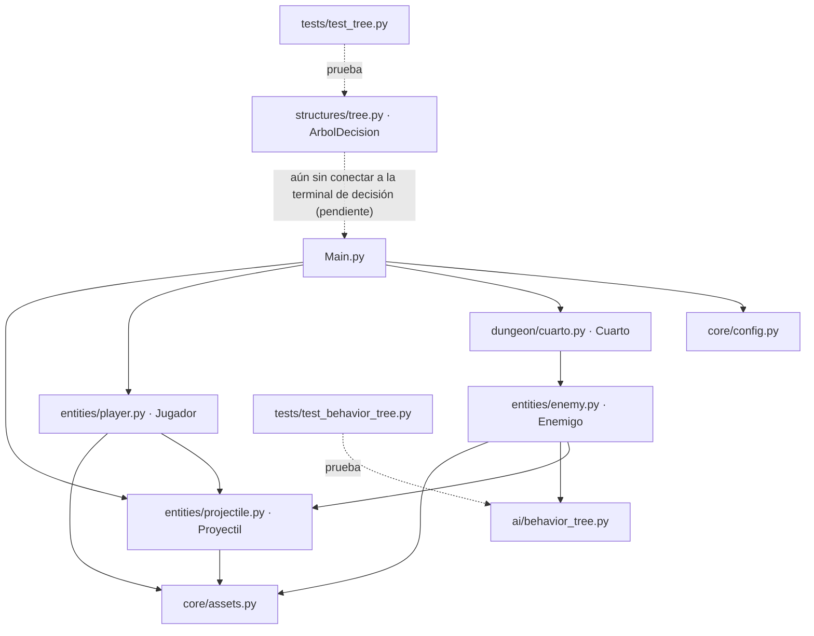

# Arquitectura de Civitas (estado actual del código)

Este documento describe el código tal como existe hoy en el repositorio,
no el diseño aspiracional completo del juego. Se regenera manualmente
cada vez que la estructura de `src/` cambia de forma significativa.

## 1. Árbol de carpetas

```text
PruebaPythonGame/
├── Main.py                  # Punto de entrada: crea la ventana y corre el loop principal.
├── requirements.txt
├── src/
│   ├── ai/
│   │   └── behavior_tree.py # Árbol de comportamiento genérico (Node/Selector/Sequence/Action).
│   ├── core/
│   │   ├── config.py        # Tamaño de ventana, FPS, reloj: configuración global de pantalla.
│   │   └── assets.py        # Colores/tamaños/velocidades centralizados de cada entidad visual.
│   ├── structures/
│   │   └── tree.py          # Árbol N-ario manual (CRUD + 4 recorridos), sin pygame.
│   ├── entities/
│   │   ├── player.py        # Jugador (Ciudadano): movimiento, vida, ataque en abanico.
│   │   ├── projectile.py    # Proyectil genérico, usado por jugador y enemigos.
│   │   └── enemy.py         # Enemigo: posición/vida + IA delegada al behavior tree.
│   └── dungeon/
│       └── cuarto.py        # Cuarto: puertas N/S/E/W y la lista de enemigos que las bloquean.
└── tests/
    ├── test_tree.py         # Tests de structures/tree.py, en aislado.
    └── test_behavior_tree.py # Tests de ai/behavior_tree.py, en aislado.
```

Responsabilidad y límites de cada carpeta, según el código real:

- **`src/core/`** — configuración global (tamaño de ventana, reloj) y la
  paleta/tamaños/velocidades centralizados de los elementos visuales. No
  debe contener lógica de juego, entidades ni referencias a otras
  carpetas de `src/`.
- **`src/structures/`** — estructuras de datos académicas puras
  (actualmente solo el árbol N-ario de `tree.py`). No importa `pygame`
  ni ningún otro módulo del proyecto; es deliberadamente autónomo para
  poder probarse y sustentarse en aislado.
- **`src/ai/`** — lógica de decisión reutilizable y agnóstica de
  `pygame` (el behavior tree). **Nota:** esta carpeta no estaba en la
  lista de carpetas "obligatorias" original de `CLAUDE.md`
  (`core/structures/entities/dungeon/ui/network`); se creó porque el
  behavior tree no es información de juego pygame ni una entidad, sino
  una estructura de control igual de "pura" que `structures/tree.py`.
  Vale la pena que el equipo decida si se documenta oficialmente así o
  si prefieren fusionarla con `structures/`.
- **`src/entities/`** — el "qué" del juego: jugador, proyectiles y
  enemigos, con su propio estado (posición, vida) y su propio
  `dibujar()`. No manejan el bucle principal ni conocen los límites de
  la ventana más allá de lo que reciben por parámetro.
- **`src/dungeon/`** — el cuarto como contenedor: posiciona puertas y
  enemigos, y decide si las puertas están bloqueadas. No conoce
  detalles internos del jugador salvo la referencia que reenvía a los
  enemigos para que persigan/disparen.
- **`tests/`** — pruebas `pytest` de la lógica pura (árbol de decisión y
  behavior tree), sin abrir ninguna ventana de `pygame`.

## 2. Módulos, clases y dependencias

### `src/core/config.py`

Sin clases. Constantes: `ANCHO_PANTALLA`, `ALTO_PANTALLA`, `FPS`,
`TITULO_VENTANA`, `COLOR_FONDO`.

- `crear_pantalla()` — inicializa la ventana de `pygame` con el tamaño y
  título del proyecto y retorna la `Surface`.
- `crear_reloj()` — crea el `pygame.time.Clock()` usado para limitar el
  loop principal a `FPS`.

**Dependencias:** solo `pygame`.

### `src/core/assets.py`

Sin clases. Constantes agrupadas por entidad:

- Jugador: `TAMANIO_JUGADOR`, `COLOR_JUGADOR`, `VELOCIDAD_JUGADOR`, `VIDA_JUGADOR`.
- Proyectiles: `TAMANIO_PROYECTIL`, `COLOR_PROYECTIL_JUGADOR`, `COLOR_PROYECTIL_ENEMIGO`, `VELOCIDAD_PROYECTIL`, `DANIO_PROYECTIL_JUGADOR`, `DANIO_PROYECTIL_ENEMIGO`.
- Enemigo: `TAMANIO_ENEMIGO`, `COLOR_ENEMIGO`, `VELOCIDAD_ENEMIGO`, `VIDA_ENEMIGO`, `RANGO_DISPARO_ENEMIGO`, `COOLDOWN_DISPARO_ENEMIGO`.

**Dependencias:** ninguna. Es un módulo hoja: todo lo demás lo importa a
él, él no importa nada del proyecto.

### `src/structures/tree.py`

- **`NodoArbol`** — un nodo del árbol N-ario. Atributos: `id`,
  `etiqueta`, `hijos` (lista de `NodoArbol`). No expone métodos
  propios; es el contenedor de datos que manipula `ArbolDecision`.
- **`ArbolDecision`** — árbol N-ario con CRUD y los 4 recorridos
  clásicos. Atributo: `raiz` (`NodoArbol` o `None`).
  - `buscar(id)` — DFS que retorna el nodo con ese id o `None`.
  - `insertar(id_padre, id_nuevo, etiqueta)` — agrega un hijo al nodo
    `id_padre`; valida padre inexistente e id duplicado.
  - `eliminar(id)` — borra el nodo y todo su subárbol.
  - `preorden()` / `inorden()` / `postorden()` / `por_niveles()` —
    retornan la lista de etiquetas en cada orden de recorrido.

**Dependencias:** `collections.deque` (stdlib). No importa `pygame` ni
otros módulos del proyecto.

### `src/ai/behavior_tree.py`

Constantes de estado: `EXITO`, `FALLO`, `EN_PROGRESO`.

- **`Node`** — clase base abstracta; `tick()` lanza `NotImplementedError`.
- **`Selector(Node)`** — atributo `hijos`. `tick()` prueba a cada hijo en
  orden y retorna el primer `EXITO`/`EN_PROGRESO`; si todos fallan,
  retorna `FALLO`.
- **`Sequence(Node)`** — atributo `hijos`. `tick()` ejecuta a cada hijo
  en orden y retorna el primer `FALLO`/`EN_PROGRESO`; si todos tienen
  éxito, retorna `EXITO`.
- **`Action(Node)`** — atributo `callback` (función sin argumentos).
  `tick()` delega en el callback y retorna lo que este devuelva.

**Dependencias:** ninguna. Módulo puro; lo usa `src/entities/enemy.py`.

### `src/entities/projectile.py`

- **`Proyectil`** — atributos: `rect` (`pygame.Rect`), `posicion`
  (`pygame.Vector2`, fuente de verdad de la posición real), `direccion`
  (`pygame.Vector2` normalizado), `velocidad`, `danio`, `color`, `vivo`
  (`bool`).
  - `actualizar(dt, limites)` — avanza `posicion`, sincroniza `rect` y
    marca `vivo = False` si el proyectil quedó fuera de `limites`.
  - `colisiona_con(otro_rect)` — `True` si sigue vivo y su rect se
    solapa con `otro_rect`.
  - `dibujar(pantalla)` — pinta su `rect` con `self.color`.

**Dependencias:** `pygame`; `src.core.assets` (tamaño por defecto). Es
importado por `player.py` y `enemy.py` para crear sus disparos.

### `src/entities/player.py`

Constante: `ANGULO_ABANICO_GRADOS = 30`.

- **`Jugador`** — atributos: `rect`, `posicion` (`Vector2`), `vida`,
  `direccion_mirada` (`Vector2`, última dirección de movimiento, usada
  para apuntar el abanico). Pensada como clase base: los otros 3 roles
  (Influencer, Periodista, Candidato) heredarían de `Jugador` y
  sobreescribirían el ataque sin tocar movimiento/vida.
  - Propiedad `vivo` — `True` mientras `vida > 0`.
  - `manejar_movimiento(teclas, dt, limites)` — lee WASD/flechas, mueve
    `posicion`/`rect` y hace `clamp` contra `limites`.
  - `disparar_abanico()` — crea y retorna 3 `Proyectil` en abanico
    (±30° y 0°) alrededor de `direccion_mirada`.
  - `recibir_dano(danio)` — resta `danio` a `vida`.
  - `dibujar(pantalla)` — pinta su `rect` con `assets.COLOR_JUGADOR`.

**Dependencias:** `pygame`; `src.core.assets`; `src.entities.projectile.Proyectil`.

### `src/entities/enemy.py`

- **`Enemigo`** — atributos: `rect`, `posicion` (`Vector2`), `vida`,
  `cooldown_disparo`, `arbol` (el `Selector` raíz del behavior tree), y
  el contexto de frame (`_jugador`, `_dt`, `_proyectiles_salida`) que
  llenan las `Action` del árbol.
  - Propiedad `vivo` — `True` mientras `vida > 0`.
  - `actualizar(dt, jugador, proyectiles_enemigos)` — guarda el
    contexto del frame y hace `tick()` al árbol raíz.
  - `recibir_dano(danio)` — resta `danio` a `vida`.
  - `dibujar(pantalla)` — pinta su `rect` con `assets.COLOR_ENEMIGO`.
  - Métodos privados que son las hojas (`Action`) del árbol:
    `_en_rango_de_disparo`, `_perseguir_jugador`, `_disparar_a_jugador`
    (respeta `cooldown_disparo` pero siempre retorna `EXITO`),
    `_quedarse_quieto`.

**Dependencias:** `pygame`; `src.ai.behavior_tree` (`Selector`,
`Sequence`, `Action`, `EXITO`, `FALLO`) para su IA;
`src.core.assets`; `src.entities.projectile.Proyectil` para disparar.

### `src/dungeon/cuarto.py`

- **`Puerta`** — atributos `direccion`, `rect`, `bloqueada`.
  - `color()` — retorna el color de la puerta según `bloqueada`.
- **`Cuarto`** — atributos: `rect` (límites del cuarto), `puertas`
  (`dict` `N`/`S`/`E`/`W` → `Puerta`), `enemigos` (lista de `Enemigo`).
  - `actualizar(dt, jugador, proyectiles_enemigos)` — hace `tick` de IA
    a cada enemigo vivo, filtra los muertos y refresca el estado de las
    puertas si cambió la cantidad de enemigos.
  - `eliminar_un_enemigo()` — debug: quita un enemigo y refresca puertas.
  - `manejar_evento(evento)` — atiende la tecla de debug
    (`TECLA_DEBUG_ELIMINAR_ENEMIGO`).
  - `dibujar(pantalla)` — pinta muros, puertas, y delega en cada
    `enemigo.dibujar(pantalla)`.

**Dependencias:** `pygame`; `src.entities.enemy.Enemigo` (para poblar el
cuarto). Es importado por `Main.py`.

### `Main.py`

Sin clases. Funciones:

- `main()` — el loop principal: crea ventana/reloj/cuarto/jugador,
  procesa eventos, actualiza jugador/cuarto/proyectiles, resuelve
  colisiones y dibuja todo cada frame.
- `_actualizar_proyectiles(proyectiles, dt, limites)` — avanza una
  lista de proyectiles y descarta los que ya no están `vivo`.
- `_resolver_colisiones_contra_enemigos(proyectiles, enemigos)` —
  aplica daño a un enemigo si un proyectil del jugador lo impacta.
- `_resolver_colision_contra_jugador(proyectiles, jugador)` — aplica
  daño al jugador si un proyectil enemigo lo impacta.

**Dependencias:** `pygame`; `src.core.config`; `src.dungeon.cuarto.Cuarto`;
`src.entities.player.Jugador`. Es el único módulo que conoce a todos
los demás: orquesta el loop pero no contiene mecánica propia (la
delega en `Cuarto`, `Jugador` y `Proyectil`).

## 3. Diagrama de relaciones entre módulos



Notas sobre el diagrama:

- `structures/tree.py` (`ArbolDecision`) ya existe y tiene tests, pero
  **todavía no está conectado** al loop principal: la "terminal de
  decisión contra reloj" que debe usarlo no se ha construido. Por eso
  aparece con una flecha punteada, no una dependencia real.
- `src/core/config.py` no depende de nada del proyecto; es la raíz de
  configuración que `Main.py` consume directamente.
- No existe todavía `src/ui/` ni `src/network/`, así que no aparecen en
  el diagrama.

## 4. Convenciones actuales

Reglas que ya están aplicadas en el código, no solo declaradas en
`CLAUDE.md`:

- **Colores/tamaños/velocidades de entidades, centralizados en un solo
  archivo.** `src/core/assets.py` agrupa todas las constantes visuales
  y de balance de `Jugador`, `Proyectil` y `Enemigo`. Ninguno de esos
  tres módulos define un color o velocidad "suelto": todos importan
  `from src.core import assets`. (Los colores de muros/puertas de
  `dungeon/cuarto.py` — `COLOR_MURO`, `COLOR_PUERTA_*` — todavía viven
  como constantes locales de ese módulo, de antes de que existiera
  `assets.py`; no se han migrado.)
- **Cada entidad dibuja su propio `rect`.** `Cuarto.dibujar` no conoce
  el color de un enemigo: llama a `enemigo.dibujar(pantalla)`. Esto es
  lo que permite que reemplazar un color por un sprite real sea un
  cambio de un solo archivo (`assets.py`), sin tocar `cuarto.py` ni
  `Main.py`.
- **Posición real en `float`, `rect` solo para dibujar/colisionar.**
  `pygame.Rect` guarda solo enteros. Por eso, tanto `Jugador` como
  `Enemigo` como `Proyectil` guardan su posición real en un
  `pygame.Vector2` (`self.posicion`) y solo redondean hacia
  `rect.center` al final de cada actualización — evitar esto hacía que
  la velocidad configurada en `assets.py` no se cumpliera de verdad
  (se comprobó que un enemigo a `VELOCIDAD_ENEMIGO = 90` se movía a
  ~60 px/s si se mutaba `rect.x`/`rect.y` directamente).
- **La IA del enemigo no tiene `if`s de estado a mano.** Todo el
  comportamiento de `Enemigo` pasa por un único `Selector` (atributo
  `arbol`); los métodos privados (`_en_rango_de_disparo`,
  `_perseguir_jugador`, etc.) son solo hojas `Action` sin lógica de
  combinación entre sí — esa lógica vive exclusivamente en
  `Selector`/`Sequence`.
- **Un nodo de "intentar algo con cooldown" siempre retorna éxito.**
  `Enemigo._disparar_a_jugador` retorna `EXITO` incluso si el cooldown
  se lo impide, para que el `Selector` no confunda "no puede disparar
  todavía" con "debería dejar de perseguir".
- **Cada estructura de datos pura tiene su test en aislado.**
  `structures/tree.py` y `ai/behavior_tree.py` no importan `pygame`, y
  cada uno tiene un archivo en `tests/` que los ejercita sin abrir
  ninguna ventana (`tests/test_tree.py`, `tests/test_behavior_tree.py`),
  siguiendo el mismo patrón de `sys.path.insert` + `pytest` en ambos.
- **`structures/` y `ai/` siguen la regla de "sin pygame".** Ninguno de
  los dos importa `pygame`; solo lo hacen los módulos de `entities/`,
  `dungeon/` y `core/config.py`, que sí necesitan dibujar o leer
  entrada.
