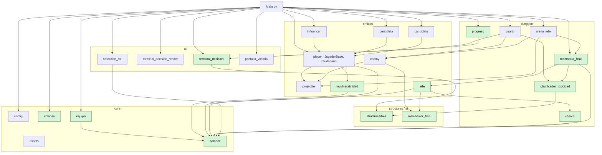

# Arquitectura de Civitas (estado actual del código)

Este documento describe el código tal como existe hoy en el repositorio,
no el diseño aspiracional completo del juego. Se regenera manualmente
cada vez que la estructura de `src/` cambia de forma significativa.

**Lo que todavía no existe** (y por eso no aparece aquí): `src/network/`
(sockets, Entrega Final), la ciudad recorrible y cualquier grafo
(`graph.py`, un grafo de ciudad o su render de mapa: Entrega 2), ni un
módulo de mazmorra multi-cuarto. Hoy hay un único cuarto normal y la
mazmorra final de un solo cuarto.

## 1. Árbol de carpetas

```text
PruebaPythonGame/
├── Main.py                         # Punto de entrada: selección de rol + máquina de estados de escena.
├── requirements.txt
├── src/
│   ├── ai/
│   │   └── behavior_tree.py        # Behavior tree genérico (Node/Selector/Sequence/Action). Puro.
│   ├── core/
│   │   ├── config.py               # Tamaño de ventana, FPS, título, reloj.
│   │   ├── assets.py               # TODAS las constantes visuales (colores, tamaños, posiciones del HUD).
│   │   ├── balance.py              # Números de balance: stats por rol, jefe, charcos, i-frames. Puro.
│   │   ├── colapso.py              # ColapsoElectoral: porcentaje 0-100 que sube/baja. Puro.
│   │   └── equipo.py               # Carga compartida de habilidad entre aliados. Puro.
│   ├── structures/
│   │   └── tree.py                 # Árbol N-ario manual (CRUD + 4 recorridos). Puro.
│   ├── entities/
│   │   ├── projectile.py           # Proyectil base y ProyectilConEstela (jefe).
│   │   ├── player.py               # JugadorBase (común a los 4 roles) y el rol Ciudadano.
│   │   ├── influencer.py           # Rol Influencer + ProyectilEmpuje.
│   │   ├── periodista.py           # Rol Periodista + RayoPerforante.
│   │   ├── candidato.py            # Rol Candidato + OndaExpansiva + ProyectilRebotante.
│   │   ├── invulnerabilidad.py     # Ventana de i-frames tras un golpe. Puro.
│   │   ├── enemy.py                # Enemigo con IA de behavior tree.
│   │   └── jefe.py                 # Jefe "Servidor Central": fases, escudo, patrones. Puro.
│   ├── dungeon/
│   │   ├── clasificador_toxicidad.py # Árbol de reportes -> nivel de toxicidad -> dificultad. Puro.
│   │   ├── cuarto.py               # Cuarto normal: puertas, enemigos, fases combate/decisión/resuelto.
│   │   ├── progreso.py             # Mazmorras completadas (solo Purificación Exitosa). Puro.
│   │   ├── charco.py               # Charco tóxico: aviso + fase activa con daño. Puro.
│   │   ├── mazmorra_final.py       # Reglas de la pelea final, tiempo, victoria/derrota, desbloqueo. Puro.
│   │   └── arena_jefe.py           # Cuerpo Pygame de la mazmorra final: rects, súbditos, dibujo.
│   └── ui/
│       ├── terminal_decision.py    # Minijuego de decisión sobre el árbol N-ario. Puro.
│       ├── terminal_decision_render.py # Dibujo de la terminal.
│       ├── seleccion_rol.py        # Dibujo de la pantalla de selección con barras de stats.
│       └── pantalla_victoria.py    # Dibujo de la pantalla de victoria (ENTER / ESC).
└── tests/                          # pytest; la mayoría sin abrir ventana (ver sección 4).
```

Responsabilidad y límites de cada carpeta, según el código real:

- **`src/core/`** — configuración global, constantes (`assets.py` para
  lo visual, `balance.py` para los números de juego) y dos reglas
  globales puras (`colapso.py`, `equipo.py`). Solo se importa a sí
  misma: nunca importa `entities/`, `dungeon/` ni `ui/`.
- **`src/structures/`** — estructuras de datos académicas puras (el
  árbol N-ario). No importa `pygame` ni nada del proyecto.
- **`src/ai/`** — el behavior tree genérico, igual de puro que
  `structures/`. No estaba en la lista original de carpetas de
  `CLAUDE.md`; hoy sí está documentada allí.
- **`src/entities/`** — jugadores, enemigos, jefe y proyectiles, cada uno
  con su estado y su `dibujar()`. El jefe y la invulnerabilidad son
  lógica pura; el resto usa `pygame.Rect`/`Vector2`.
- **`src/dungeon/`** — los lugares donde se pelea (cuarto normal y
  arena del jefe) y sus reglas: clasificación de toxicidad, progreso,
  charcos y la mazmorra final.
- **`src/ui/`** — el minijuego de decisión (lógica pura) y el dibujo de
  pantallas que no son mundo de juego (terminal, selección, victoria).

## 2. Módulos, clases y dependencias

### `src/core/`

**`config.py`** — sin clases. `ANCHO_PANTALLA`, `ALTO_PANTALLA`, `FPS`,
`TITULO_VENTANA`; `crear_pantalla()` y `crear_reloj()`.
*Depende de:* `pygame`.

**`assets.py`** — sin clases. Todas las constantes visuales: colores,
tamaños y posiciones de jugador, roles, proyectiles, enemigo, jefe,
charcos, muros/puertas, HUD, terminal, selección, victoria, sacudida y
parpadeos. También algunos números de comportamiento previos a
`balance.py` (velocidades de proyectiles, vida del enemigo, duraciones
de habilidades).
*Depende de:* nada. Módulo hoja.

**`balance.py`** — puro.
- **`StatsRol`** (dataclass inmutable): `velocidad_mult`, `cadencia`,
  `danio_mult`, `vida_mult`, `carga_maxima`, `proyectiles_nominales`.
- `STATS_POR_ROL` (rol → `StatsRol`), valores base (`VELOCIDAD_BASE`,
  `VIDA_BASE`, `DANIO_BASE`), límites de cadencia, buff por kill,
  `CARGA_COMPARTIDA`, `INVULNERABILIDAD_DURACION` y todas las
  constantes del jefe, charcos y mazmorra final.
- `intervalo_disparo(cadencia, buff_activo)`, `dps_nominal(stats)`,
  `stats_normalizadas()`.

*Depende de:* nada del proyecto.

**`colapso.py`** — puro. **`ColapsoElectoral`**: `valor` acotado a
[0, 100]; `sumar_fallo()` (+0.2), `restar_exito()` (-0.1), `texto()`.
*Depende de:* nada.

**`equipo.py`** — puro. `registrar_kill_equipo(asesino, aliados)`: kill
completa al asesino y `CARGA_COMPARTIDA` a cada aliado.
*Depende de:* `balance`.

### `src/structures/tree.py`

Puro. **`NodoArbol`** (`id`, `etiqueta`, `hijos`) y **`ArbolDecision`**
(`raiz`; `buscar`, `insertar`, `eliminar`, `preorden`, `inorden`,
`postorden`, `por_niveles`, todas O(n)). Gobierna dos mecánicas: el
clasificador de toxicidad y la terminal de decisión.
*Depende de:* `collections.deque`.

### `src/ai/behavior_tree.py`

Puro. Estados `EXITO`, `FALLO`, `EN_PROGRESO`; **`Node`**,
**`Selector`**, **`Sequence`**, **`Action`**.
*Lo usan:* `enemy.py` y `jefe.py`.

### `src/entities/`

**`projectile.py`**
- **`Proyectil`** — `rect`, `posicion`, `direccion`, `velocidad`,
  `danio`, `color`, `vivo`; `actualizar(dt, limites)`,
  `colisiona_con(rect)`, `al_impactar(enemigo)` (por defecto daña y se
  destruye; cada rol lo sobreescribe), `dibujar`.
- **`ProyectilConEstela(Proyectil)`** — redondo, guarda las 3 últimas
  posiciones (separadas por espacio, no por frame) y las dibuja con
  transparencia decreciente. Lo usa el jefe.

*Depende de:* `pygame`, `assets`.

**`invulnerabilidad.py`** — puro. **`Invulnerabilidad`**:
`tiempo_restante`, `activa`, `actualizar(dt)`,
`aplicar_golpe(vida, danio, inicia=True)` (no resta durante la ventana
y no la reinicia), `visible` (parpadeo), `reiniciar()`.
*Depende de:* `assets`, `balance`.

**`player.py`**
- **`JugadorBase`** — identidad del rol (`rol`, `COLOR`, `NOMBRE`,
  `NOMBRE_HABILIDAD`); stats leídas de `STATS_POR_ROL[rol]`
  (`velocidad`, `vida_maxima`, `danio`, `carga_maxima`); `invulnerabilidad`.
  Métodos: `manejar_movimiento`, `actualizar_disparo(dt, disparando)`
  (disparo sostenido con acumulador), `registrar_kill`, `sumar_carga`,
  `puede_usar_habilidad`, `recibir_dano(danio, inicia_invulnerabilidad)`,
  `actualizar_invulnerabilidad`, `dibujar`. Interfaz a sobreescribir:
  `ataque_basico()` y `usar_habilidad(enemigos, proyectiles_salida)`.
- **`Ciudadano(JugadorBase)`** — abanico de 3 proyectiles / Burbuja
  Comunitaria (flag con duración; todavía sin frenar proyectiles ni curar).

*Depende de:* `pygame`, `assets`, `balance`, `invulnerabilidad`, `projectile`.

**`influencer.py`** — **`ProyectilEmpuje(Proyectil)`** (ancho; al
impactar daña y llama `enemigo.empujar`) e **`Influencer(JugadorBase)`**
(Live Stream Viral: `forzar_objetivo` en cada enemigo vivo, 3 s).
*Depende de:* `assets`, `player`, `projectile`.

**`periodista.py`** — **`RayoPerforante(Proyectil)`** (no se destruye
al impactar; daña una vez a cada enemigo; con `quita_escudo` pone
`escudo_anonimato = False`) y **`Periodista(JugadorBase)`**
(Fact-Checking).
*Depende de:* `pygame`, `assets`, `player`, `projectile`.

**`candidato.py`** — **`OndaExpansiva`** (área circular que crece;
misma interfaz que `Proyectil` por duck typing),
**`ProyectilRebotante(Proyectil)`** (invierte x/y en los bordes) y
**`Candidato(JugadorBase)`** (Debate Rebotante).
*Depende de:* `pygame`, `assets`, `player`, `projectile`.

**`enemy.py`** — **`Enemigo`**: `vida`, `velocidad`, `escudo_anonimato`,
`objetivo_forzado`, `arbol` (Selector: aggro forzado → en rango →
quieto). `actualizar`, `forzar_objetivo`, `recibir_dano` (ignorado con
escudo), `empujar`, `mantener_dentro`, `dibujar`.
*Depende de:* `pygame`, `behavior_tree`, `assets`, `projectile`.

**`jefe.py`** — puro.
- `fase_por_vida(fraccion)`: >60% → 1, >30% → 2, resto → 3.
- **`DisparoJefe`** y **`SalidaJefe`** (dataclasses): lo que el jefe
  produce en un frame (disparos como datos, charcos, invocaciones).
- **`Jefe`** — behavior tree propio (Selector: cambio de fase → fase 3
  → fase 2 → fase 1), `vida`, `fase`, `escudo_anonimato` (propiedad: 15
  impactos; asignar `False` lo rompe de golpe), `eventos` (para la
  sacudida). Se comporta como enemigo ante los ataques (`vivo`, `rect`
  asignado por la arena, `recibir_dano`, `empujar` y `forzar_objetivo`
  sin efecto).

*Depende de:* `behavior_tree`, `assets`, `balance`, `dungeon/charco`.

### `src/dungeon/`

**`clasificador_toxicidad.py`** — puro. `construir_arbol_reportes`,
`calcular_nivel_toxicidad` (recorrido por niveles, O(n)) y
`nivel_a_dificultad(nivel)` → `{cantidad_enemigos, multiplicador_velocidad}`.
*Depende de:* `structures/tree`.

**`cuarto.py`** — **`Puerta`** y **`Cuarto`** (`rect`, `puertas`,
`enemigos`, `fase` combate/decision/resuelto, `terminal`). Al morir el
último enemigo pasa a `"decision"` y crea la `TerminalDecision`.
*Depende de:* `pygame`, `assets`, `clasificador_toxicidad`, `enemy`,
`ui/terminal_decision`.

**`progreso.py`** — puro. **`ProgresoPartida`**:
`mazmorras_completadas`; `registrar_decision(resultado, colapso)` (solo
Purificación Exitosa suma al contador; Detonación suma colapso).
*Depende de:* `ui/terminal_decision` (constantes de resultado).

**`charco.py`** — puro. **`Charco`**: `x`, `y`, `radio`, `tiempo`;
`en_aviso`, `activo`, `vivo`, `actualizar`, `contiene`,
`danio_para(x, y, dt)`.
*Depende de:* `balance`.

**`mazmorra_final.py`** — puro. `esta_desbloqueada(colapso,
mazmorras_completadas)` (colapso > 80 o al menos 1 completada) y
**`MazmorraFinal`**: `jefe`, `charcos`, `tiempo_restante`, `estado`
(combate/victoria), `dificultad` (toxicidad 100), `actualizar(dt,
jugador)`, `texto_mensaje()`, `desplazamiento_sacudida()`. Nunca
importa ni crea `TerminalDecision`.
*Depende de:* `assets`, `balance`, `clasificador_toxicidad`, `entities/jefe`.

**`arena_jefe.py`** — **`ArenaJefe`**: misma interfaz que `Cuarto`
(`rect`, `enemigos`, `actualizar`, `dibujar`, `manejar_evento`) más
`dibujar_hud`. Da `rect` al jefe, convierte cada `DisparoJefe` en
`ProyectilConEstela`, crea súbditos `Enemigo` (tope y velocidad del
tramo de toxicidad máximo) y dibuja jefe, charcos, barra y tiempo.
*Depende de:* `pygame`, `assets`, `balance`, `mazmorra_final`, `enemy`,
`projectile`.

### `src/ui/`

**`terminal_decision.py`** — puro. `construir_arbol_publicacion()` y
**`TerminalDecision`** (`iniciar`, `navegar`, `actualizar`,
`resultado`).
*Depende de:* `structures/tree`.

**`terminal_decision_render.py`**, **`seleccion_rol.py`**,
**`pantalla_victoria.py`** — funciones de dibujo
(`dibujar_terminal`, `dibujar_seleccion`, `dibujar_victoria`).
*Dependen de:* `pygame`, `assets` (y `balance` en el caso de
`seleccion_rol`).

### `Main.py`

- **`Escena`** (Enum): `MAZMORRA`, `DECISION`, `JEFE`, `VICTORIA`.
- `main()` — selección de rol, luego el loop con la máquina de estados:
  el input, la actualización y el dibujo dependen de la escena.
- `_frame_de_combate(...)` — un frame de combate idéntico en el cuarto y
  en la arena.
- `_elegir_rol`, `_colocar_en_cuarto`, `_dibujar_hud`,
  `_actualizar_proyectiles`, `_resolver_colisiones_contra_enemigos`
  (delega en `al_impactar` y reparte carga con `registrar_kill_equipo`),
  `_resolver_colision_contra_jugador`.

*Depende de:* casi todo; es el único módulo que conoce a todos y no
contiene mecánica propia.

## 3. Diagrama de dependencias entre módulos

Flechas = "importa a". En verde, los módulos puros (sin `pygame`).



Para no saturar el diagrama no se dibujan las flechas hacia
`core/assets.py`: casi todos los módulos con algo visible lo importan,
y él no importa nada.

Notas:
- **Dos usos del árbol N-ario**: `clasificador_toxicidad` (lógica de
  fondo que decide la dificultad) y `terminal_decision` (el jugador
  navega el árbol nodo a nodo).
- **Dos usos del behavior tree**: `Enemigo` (aggro forzado / en rango /
  quieto) y `Jefe` (una Sequence por fase).
- **Dependencias entre carpetas que conviene conocer**:
  `entities/jefe → dungeon/charco` (el jefe suelta charcos),
  `dungeon/cuarto` y `dungeon/progreso → ui/terminal_decision` (la
  decisión vive en `ui/` porque es una interfaz que el jugador navega).
- **Lógica pura + cuerpo Pygame**: `MazmorraFinal`/`Jefe`/`Charco` no
  conocen Pygame; `ArenaJefe` les da rects, proyectiles reales y dibujo.
  Lo mismo hacen `TerminalDecision` / `terminal_decision_render`.

## 4. Convenciones actuales

Reglas que ya están aplicadas en el código, no solo declaradas en
`CLAUDE.md`:

- **Lo visual en `assets.py`, el balance en `balance.py`.** Ningún
  módulo define un color suelto: también los muros/puertas del cuarto y
  el color de fondo viven en `assets.py`. Las clases de rol no guardan
  números de balance: leen `STATS_POR_ROL[self.rol]`.
- **Interfaz común entre roles y entre escenarios.** Los 4 roles
  heredan de `JugadorBase` y solo sobreescriben `ataque_basico()` y
  `usar_habilidad()`. Todo proyectil (o efecto) resuelve su choque con
  `al_impactar(enemigo)`. `Cuarto` y `ArenaJefe` exponen los mismos
  métodos. Por eso `Main.py` tiene un único loop de combate.
- **Flujo de juego como máquina de estados explícita** (`Escena` en
  `Main.py`), en vez de banderas sueltas.
- **Lógica separada del dibujo donde se necesita probar sin ventana.**
  Son puros: `structures/`, `ai/`, `balance`, `colapso`, `equipo`,
  `invulnerabilidad`, `jefe`, `clasificador_toxicidad`, `progreso`,
  `charco`, `mazmorra_final` y `terminal_decision`. Los tests de
  `terminal_decision`, `balance`/`equipo`, `invulnerabilidad` y
  `jefe`/`charco`/`mazmorra_final` verifican además, en un proceso
  aparte, que importarlos no carga `pygame`.
- **Posición real en `float`, `rect` solo para dibujar/colisionar.**
  `pygame.Rect` guarda enteros; jugador, enemigos y proyectiles guardan
  la posición en un `Vector2` y redondean al final de cada frame.
- **La IA no tiene `if`s de estado a mano.** Enemigo y jefe deciden
  todo con su `Selector` raíz; los métodos privados son hojas `Action`.
- **Un nodo "intentar algo con cooldown" siempre retorna éxito**, para
  que el `Selector` no confunda "todavía no puede" con "debería dejar
  esta rama".
- **Cadencias independientes del framerate.** El disparo del jugador y
  los ataques del jefe usan acumuladores que conservan el sobrante del
  frame.
- **Tests** (`tests/`, pytest): `test_tree`, `test_behavior_tree`,
  `test_clasificador_toxicidad`, `test_terminal_decision`,
  `test_balance`, `test_mazmorra_final`, `test_invulnerabilidad` y
  `test_progreso` no usan `pygame`; `test_player_habilidad` y
  `test_roles` usan `pygame.Rect`/`Vector2` sin abrir ventana.
