# Arquitectura de Civitas (estado actual del código)

Este documento describe el código tal como existe hoy en el repositorio,
no el diseño aspiracional completo del juego. Se regenera manualmente
cada vez que la estructura de `src/` cambia de forma significativa.

**Lo que todavía no existe** (y por eso no aparece aquí): `src/network/`
(sockets, Entrega Final) y Ciudad Nova como mundo abierto caminable. La
ciudad hoy es un mapa de selección sobre un grafo ponderado, desde el
que se viaja a 3 mazmorras normales de 6 cuartos (grafo de cuartos) y a
la mazmorra final de un solo cuarto.

## 1. Árbol de carpetas

```text
PruebaPythonGame/
├── Main.py                         # Punto de entrada: selección de rol + máquina de estados de escena.
├── requirements.txt
├── src/
│   ├── ai/
│   │   └── behavior_tree.py        # Behavior tree genérico (Node/Selector/Sequence/Action). Puro.
│   ├── core/
│   │   ├── config.py               # Tamaño de ventana, FPS, título, reloj.
│   │   ├── assets.py               # TODAS las constantes visuales (colores, tamaños, posiciones del HUD).
│   │   ├── balance.py              # Números de balance: stats por rol, jefe, charcos, i-frames. Puro.
│   │   ├── colapso.py              # ColapsoElectoral: porcentaje 0-100 que sube/baja. Puro.
│   │   ├── equipo.py               # Carga compartida de habilidad entre aliados. Puro.
│   │   ├── escenas.py              # Enum Escena + transición a DERROTA por colapso. Puro.
│   │   └── apuntado.py             # Dirección unitaria hacia el mouse con zona muerta. Puro (solo math).
│   ├── structures/
│   │   ├── tree.py                 # Árbol N-ario manual (CRUD + 4 recorridos). Puro.
│   │   ├── min_heap.py             # Montículo binario de mínimos manual (cola de prioridad). Puro.
│   │   └── graph.py                # Grafo ponderado: CRUD, BFS, DFS, es_conexo, camino, Dijkstra. Puro.
│   ├── entities/
│   │   ├── projectile.py           # Proyectil base y ProyectilConEstela (jefe).
│   │   ├── player.py               # JugadorBase (común a los 4 roles) y el rol Ciudadano.
│   │   ├── influencer.py           # Rol Influencer + ProyectilEmpuje.
│   │   ├── periodista.py           # Rol Periodista + RayoPerforante.
│   │   ├── candidato.py            # Rol Candidato + OndaExpansiva + ProyectilRebotante.
│   │   ├── invulnerabilidad.py     # Ventana de i-frames tras un golpe. Puro.
│   │   ├── enemy.py                # Enemigo con IA de behavior tree.
│   │   └── jefe.py                 # Jefe "Servidor Central": fases, escudo, patrones. Puro.
│   ├── dungeon/
│   │   ├── clasificador_toxicidad.py # Árbol de reportes -> nivel de toxicidad -> dificultad. Puro.
│   │   ├── cuarto.py               # Un cuarto: puertas existentes, enemigos, fases combate/limpio/decisión/resuelto.
│   │   ├── mazmorra.py             # Mazmorra de 6 cuartos sobre un Grafo: layout, final, propagación. Puro.
│   │   ├── mazmorra_jugable.py     # Cuerpo Pygame de la mazmorra: un Cuarto por nodo, cruzar puertas.
│   │   ├── grafo_ciudad.py         # Mapa de la ciudad: Dijkstra y pesos dinámicos. Puro.
│   │   ├── partida.py              # Colapso + progreso + ciudad + ubicación; viajar, reiniciar. Puro.
│   │   ├── progreso.py             # Mazmorras completadas (solo Purificación Exitosa). Puro.
│   │   ├── charco.py               # Charco tóxico: aviso + fase activa con daño. Puro.
│   │   ├── mazmorra_final.py       # Reglas de la pelea final, tiempo, victoria/derrota, desbloqueo. Puro.
│   │   └── arena_jefe.py           # Cuerpo Pygame de la mazmorra final: rects, súbditos, dibujo.
│   └── ui/
│       ├── terminal_decision.py    # Minijuego de decisión sobre el árbol N-ario. Puro.
│       ├── terminal_decision_render.py # Dibujo de la terminal.
│       ├── seleccion_rol.py        # Dibujo de la pantalla de selección con barras de stats.
│       ├── mapa_ciudad.py          # SelectorZona (flechas izq/der). Puro.
│       ├── mapa_ciudad_render.py   # Dibujo del mapa: zonas, calles con peso, ruta más segura y costo.
│       ├── mapa_render.py          # Minimapa de la mazmorra (tecla M).
│       ├── pantalla_victoria.py    # Dibujo de la pantalla de victoria + panel final reutilizable.
│       └── pantalla_derrota.py     # Dibujo de la derrota global "Colapso total".
└── tests/                          # pytest; la mayoría sin abrir ventana (ver sección 5).
```

Responsabilidad y límites de cada carpeta, según el código real:

- **`src/core/`** — configuración global, constantes (`assets.py` para
  lo visual, `balance.py` para los números de juego) y dos reglas
  globales puras (`colapso.py`, `equipo.py`). Solo se importa a sí
  misma: nunca importa `entities/`, `dungeon/` ni `ui/`.
- **`src/structures/`** — estructuras de datos académicas puras (árbol
  N-ario, grafo y min-heap). No importa `pygame`; solo `graph` importa a
  `min_heap`.
- **`src/ai/`** — el behavior tree genérico, igual de puro que
  `structures/`. No estaba en la lista original de carpetas de
  `CLAUDE.md`; hoy sí está documentada allí.
- **`src/entities/`** — jugadores, enemigos, jefe y proyectiles, cada uno
  con su estado y su `dibujar()`. El jefe y la invulnerabilidad son
  lógica pura; el resto usa `pygame.Rect`/`Vector2`.
- **`src/dungeon/`** — los lugares donde se pelea (cuartos, mazmorra
  multi-cuarto y arena del jefe), el mapa de la ciudad y sus reglas:
  clasificación de toxicidad, progreso, partida, charcos y la mazmorra
  final.
- **`src/ui/`** — el minijuego de decisión y el selector del mapa
  (lógica pura) y el dibujo de pantallas que no son mundo de juego
  (terminal, selección, mapa de ciudad, minimapa, victoria, derrota).

## 2. Módulos, clases y dependencias

### `src/core/`

**`config.py`** — sin clases. `ANCHO_PANTALLA`, `ALTO_PANTALLA`, `FPS`,
`TITULO_VENTANA`; `crear_pantalla()` y `crear_reloj()`.
*Depende de:* `pygame`.

**`assets.py`** — sin clases. Todas las constantes visuales: colores,
tamaños y posiciones de jugador, roles, proyectiles, enemigo, jefe,
charcos, muros/puertas, HUD, terminal, selección, victoria, sacudida y
parpadeos. También algunos números de comportamiento previos a
`balance.py` (velocidades de proyectiles, vida del enemigo, duraciones
de habilidades).
*Depende de:* nada. Módulo hoja.

**`balance.py`** — puro.
- **`StatsRol`** (dataclass inmutable): `velocidad_mult`, `cadencia`,
  `danio_mult`, `vida_mult`, `carga_maxima`, `proyectiles_nominales`.
- `STATS_POR_ROL` (rol → `StatsRol`), valores base (`VELOCIDAD_BASE`,
  `VIDA_BASE`, `DANIO_BASE`), límites de cadencia, buff por kill,
  `CARGA_COMPARTIDA`, `INVULNERABILIDAD_DURACION` y todas las
  constantes del jefe, charcos y mazmorra final.
- `intervalo_disparo(cadencia, buff_activo)`, `dps_nominal(stats)`,
  `stats_normalizadas()`.

*Depende de:* nada del proyecto.

**`colapso.py`** — puro. **`ColapsoElectoral`**: `valor` acotado a
[0, 100]; `sumar_fallo()` (+0.2), `restar_exito()` (-0.1),
`sumar(cantidad)` (costo de viaje), `esta_colapsado()` (redondea a un
decimal para tolerar el error de float), `texto()`.
*Depende de:* nada.

**`apuntado.py`** — puro (solo `math`).
`calcular_direccion_apuntado(centro, punto_mouse, direccion_previa)` →
vector unitario `(x, y)` hacia el mouse, o `direccion_previa` si el
mouse está a menos de `ZONA_MUERTA_APUNTADO` px. O(1).
*Depende de:* `balance`.

**`escenas.py`** — puro. **`Escena`** (Enum): `MAPA_CIUDAD`,
`MAZMORRA`, `DECISION`, `JEFE`, `VICTORIA`, `DERROTA`;
`ESCENAS_DE_COMBATE`; `escena_tras_colapso(escena, colapso)` →
`DERROTA` si la barra llegó al 100%.
*Depende de:* nada.

**`equipo.py`** — puro. `registrar_kill_equipo(asesino, aliados)`: kill
completa al asesino y `CARGA_COMPARTIDA` a cada aliado.
*Depende de:* `balance`.

### `src/structures/tree.py`

Puro. **`NodoArbol`** (`id`, `etiqueta`, `hijos`) y **`ArbolDecision`**
(`raiz`; `buscar`, `insertar`, `eliminar`, `preorden`, `inorden`,
`postorden`, `por_niveles`, todas O(n)). Gobierna dos mecánicas: el
clasificador de toxicidad y la terminal de decisión.
*Depende de:* `collections.deque`.

### `src/structures/min_heap.py`

Puro. **`MinHeap`** sobre una lista (hijos en 2i+1 y 2i+2):
`insertar(prioridad, valor)` y `extraer_minimo()` en O(log n),
`esta_vacio()` en O(1). Desempata prioridades iguales por orden de
llegada. Lo usa `Grafo.dijkstra` como cola de prioridad.
*Depende de:* nada.

### `src/structures/graph.py`

Puro. **`Grafo`** con lista de adyacencia `{nodo: {vecino: peso}}`
(memoria O(V + E)): `agregar_nodo`, `eliminar_nodo` (O(V)),
`agregar_arista(a, b, peso=1, dirigida=False)`, `eliminar_arista`,
`existe_arista`, `peso`, `cambiar_peso`, `vecinos`, `nodos`;
`bfs(origen)` → (orden, distancias en saltos, predecesores),
`dfs(origen)` iterativo con pila explícita, `es_conexo()`,
`camino(predecesores, origen, destino)` y `dijkstra(origen)` →
(distancias, predecesores). Ver la sección 4 para qué usa el juego
cada algoritmo.
*Depende de:* `collections.deque`, `min_heap`.

### `src/ai/behavior_tree.py`

Puro. Estados `EXITO`, `FALLO`, `EN_PROGRESO`; **`Node`**,
**`Selector`**, **`Sequence`**, **`Action`**.
*Lo usan:* `enemy.py` y `jefe.py`.

### `src/entities/`

**`projectile.py`**
- **`Proyectil`** — `rect`, `posicion`, `direccion`, `velocidad`,
  `danio`, `color`, `vivo`; `actualizar(dt, limites)`,
  `colisiona_con(rect)`, `al_impactar(enemigo)` (por defecto daña y se
  destruye; cada rol lo sobreescribe), `dibujar`.
- **`ProyectilConEstela(Proyectil)`** — redondo, guarda las 3 últimas
  posiciones (separadas por espacio, no por frame) y las dibuja con
  transparencia decreciente. Lo usa el jefe.

*Depende de:* `pygame`, `assets`.

**`invulnerabilidad.py`** — puro. **`Invulnerabilidad`**:
`tiempo_restante`, `activa`, `actualizar(dt)`,
`aplicar_golpe(vida, danio, inicia=True)` (no resta durante la ventana
y no la reinicia), `visible` (parpadeo), `reiniciar()`.
*Depende de:* `assets`, `balance`.

**`player.py`**
- **`JugadorBase`** — identidad del rol (`rol`, `COLOR`, `NOMBRE`,
  `NOMBRE_HABILIDAD`); stats leídas de `STATS_POR_ROL[rol]`
  (`velocidad`, `vida_maxima`, `danio`, `carga_maxima`); `invulnerabilidad`.
  Atributo de clase `apunta_con_mouse` (True por defecto; el Candidato
  lo pone en False): decide quién actualiza `direccion_mirada` —
  `apuntar_a(punto_mouse)` (usa `core/apuntado`) o
  `manejar_movimiento` (dirección de caminata). Los ataques y la
  habilidad siempre salen de `direccion_mirada`.
  Métodos: `manejar_movimiento`, `apuntar_a`, `actualizar_disparo(dt, disparando)`
  (disparo sostenido con acumulador), `registrar_kill`, `sumar_carga`,
  `puede_usar_habilidad`, `recibir_dano(danio, inicia_invulnerabilidad)`,
  `actualizar_invulnerabilidad`, `dibujar`. Interfaz a sobreescribir:
  `ataque_basico()` y `usar_habilidad(enemigos, proyectiles_salida)`.
- **`Ciudadano(JugadorBase)`** — abanico de 3 proyectiles / Burbuja
  Comunitaria (flag con duración; todavía sin frenar proyectiles ni curar).

*Depende de:* `pygame`, `assets`, `apuntado`, `balance`, `invulnerabilidad`, `projectile`.

**`influencer.py`** — **`ProyectilEmpuje(Proyectil)`** (ancho; al
impactar daña y llama `enemigo.empujar`) e **`Influencer(JugadorBase)`**
(Live Stream Viral: `forzar_objetivo` en cada enemigo vivo, 3 s).
*Depende de:* `assets`, `player`, `projectile`.

**`periodista.py`** — **`RayoPerforante(Proyectil)`** (no se destruye
al impactar; daña una vez a cada enemigo; con `quita_escudo` pone
`escudo_anonimato = False`) y **`Periodista(JugadorBase)`**
(Fact-Checking).
*Depende de:* `pygame`, `assets`, `player`, `projectile`.

**`candidato.py`** — `apunta_con_mouse = False`. **`OndaExpansiva`** (área circular que crece;
misma interfaz que `Proyectil` por duck typing),
**`ProyectilRebotante(Proyectil)`** (invierte x/y en los bordes) y
**`Candidato(JugadorBase)`** (Debate Rebotante).
*Depende de:* `pygame`, `assets`, `player`, `projectile`.

**`enemy.py`** — **`Enemigo`**: `vida`, `velocidad`, `escudo_anonimato`,
`objetivo_forzado`, `agro_permanente` (True por defecto: el nodo de
detección siempre tiene éxito, agresividad absoluta; con False usa
`RANGO_DISPARO_ENEMIGO`), `arbol` (Selector: aggro forzado → jugador
detectado → quieto). `actualizar`, `forzar_objetivo`, `recibir_dano` (ignorado con
escudo), `empujar`, `mantener_dentro`, `dibujar`.
*Depende de:* `pygame`, `behavior_tree`, `assets`, `projectile`.

**`jefe.py`** — puro.
- `fase_por_vida(fraccion)`: >60% → 1, >30% → 2, resto → 3.
- **`DisparoJefe`** y **`SalidaJefe`** (dataclasses): lo que el jefe
  produce en un frame (disparos como datos, charcos, invocaciones).
- **`Jefe`** — behavior tree propio (Selector: cambio de fase → fase 3
  → fase 2 → fase 1). Todo patrón es esquivable: ráfaga radial con
  hueco de `JEFE_RADIAL_HUECO` balas que salta > 60° y evita muros
  (`elegir_hueco`), espiral de 2 brazos lenta, fase 3 como ciclo de 8 s
  (`tiempo_ciclo`: ráfagas → espiral → descanso sin emisiones),
  dirigido lejos de las ráfagas, tope `MAX_PROYECTILES_JEFE` (recibe
  `balas_vivas` en `actualizar`) y charcos con máximo 2 vivos y
  distancia mínima al jugador. `ultimo_hueco` queda expuesto para los
  tests; `vida`, `fase`, `escudo_anonimato` (propiedad: 15
  impactos; asignar `False` lo rompe de golpe), `eventos` (para la
  sacudida). Se comporta como enemigo ante los ataques (`vivo`, `rect`
  asignado por la arena, `recibir_dano`, `empujar` y `forzar_objetivo`
  sin efecto).

*Depende de:* `behavior_tree`, `assets`, `balance`, `dungeon/charco`.

### `src/dungeon/`

**`clasificador_toxicidad.py`** — puro. `construir_arbol_reportes`,
`calcular_nivel_toxicidad` (recorrido por niveles, O(n)) y
`nivel_a_dificultad(nivel)` → `{cantidad_enemigos, multiplicador_velocidad}`.
*Depende de:* `structures/tree`.

**`cuarto.py`** — **`Puerta`** y **`Cuarto`** (`rect`, `puertas` solo
en `direcciones_puertas`, `enemigos`, `es_final`, `fase`
combate/limpio/decision/resuelto, `terminal`). Acepta `nivel_toxicidad`
y `dificultad` ya calculados (si no, los saca de `reportes`). Al morir
el último enemigo, el cuarto final pasa a `"decision"` y crea la
`TerminalDecision`; uno intermedio pasa a `"limpio"`. Los valores por
defecto (4 puertas, `es_final=True`) conservan el comportamiento del
cuarto único original.
*Depende de:* `pygame`, `assets`, `clasificador_toxicidad`, `enemy`,
`ui/terminal_decision`.

**`mazmorra.py`** — puro. **`Mazmorra(reportes, nombre_zona,
cantidad_cuartos=6, semilla=None)`**: `grafo` de cuartos, `celdas`
(`{cuarto: (x, y)}` en la cuadrícula 3x3), `entrada`, `cuarto_final`,
`actual`, `toxicidad`, `dificultad` (solo cuartos generados),
`visitados`, `limpiados` (la entrada desde el inicio; un cuarto nunca
visitado no está limpio), `completada`, `tiempo_en_cuarto`. Métodos:
`puertas(cuarto)` → `{dirección: vecino}`, `mover(dirección)` (devuelve
None si no hay pasillo o si el destino es el final sellado),
`entrar(cuarto)` (generación perezosa), `actualizar(dt,
hay_enemigos_vivos)`, `propagar_desde(cuarto)`, `ruta_al_final()`,
`final_descubierto`.
- **Garantía de conectividad:** el cuarto final es el más lejano por BFS
  cuya eliminación deja el resto conexo (`resto_conexo_sin`: copia del
  grafo + `eliminar_nodo` + `es_conexo`); si el más lejano no cumpliera
  se prueba el siguiente. Así todos los demás cuartos se recorren sin
  pasar por el final.
- **Sello del cuarto final:** `cuartos_pendientes()` (no finales sin
  limpiar), `final_desbloqueado()`, `puede_entrar(cuarto)` (el final
  solo con todo limpio, aunque el ciclo le dé dos puertas),
  `marcar_limpiado(cuarto)` (True cuando desbloquea el final),
  `cuartos_limpios()` → (X, N) para el HUD.
- **Cierre:** `puede_iniciar_decision()` (en el final, sello cumplido y
  sin completar; el `Cuarto` final la consulta antes de abrir la
  terminal) y `completar()` (True solo la primera vez).
*Depende de:* `random`, `balance`, `clasificador_toxicidad`,
`structures/graph`.

**`mazmorra_jugable.py`** — **`MazmorraJugable`**: misma interfaz que
`Cuarto`/`ArenaJefe`. Crea un `Cuarto` por nodo la primera vez que se
entra (puertas, toxicidad, dificultad y `es_final` del grafo) y los
guarda (un cuarto limpio sigue limpio). Sella (`Puerta.sellada`) las
puertas cuyo vecino no se puede pisar todavía y guarda un `mensaje`
breve ("Limpia todos los cuartos primero" / "Cuarto final
desbloqueado"). Si el jugador toca una puerta sin enemigos y sin sello,
llama a `Mazmorra.mover` y lo ubica junto a la puerta opuesta;
`cambio_de_cuarto` avisa a `Main.py` para descartar proyectiles.
*Depende de:* `assets`, `cuarto`, `mazmorra`.

**`grafo_ciudad.py`** — puro. `ZONAS`, `ZONA_INICIO` (Plaza),
`ZONA_FINAL` (Alcaldía) y **`GrafoCiudad`**: `restablecer()`,
`zonas()`, `tiene_mazmorra_normal(zona)`, `reportes(zona)`,
`ruta_mas_segura(origen, destino)` → (camino, costo),
`actualizar_tras_mazmorra(zona, exito)` (±1, acotado a [1, 10]),
`calles()`.
*Depende de:* `balance`, `structures/graph`.

**`partida.py`** — puro. **`Partida`**: `colapso`, `progreso`,
`ciudad`, `ubicacion`; `reiniciar()`, `alcaldia_desbloqueada()`,
`ruta_hasta(destino)`, `viajar(destino)` (cobra
`COSTO_VIAJE_COLAPSO` × costo), `cerrar_mazmorra(mazmorra, resultado)`
(única vía que usa `Main.py`: aplica la decisión solo si
`mazmorra.completar()` acepta, una vez por mazmorra),
`registrar_decision(zona, resultado)`,
`hay_derrota_global()`.
*Depende de:* `balance`, `colapso`, `grafo_ciudad`, `mazmorra_final`,
`progreso`, `ui/terminal_decision`.

**`progreso.py`** — puro. **`ProgresoPartida`**:
`mazmorras_completadas`; `registrar_decision(resultado, colapso)` (solo
Purificación Exitosa suma al contador; Detonación suma colapso).
*Depende de:* `ui/terminal_decision` (constantes de resultado).

**`charco.py`** — puro. **`Charco`**: `x`, `y`, `radio`, `tiempo`;
`en_aviso`, `activo`, `vivo`, `actualizar`, `contiene`,
`danio_para(x, y, dt)`.
*Depende de:* `balance`.

**`mazmorra_final.py`** — puro. `esta_desbloqueada(colapso,
mazmorras_completadas)` (colapso > 80 o al menos 1 completada) y
**`MazmorraFinal`**: `jefe`, `charcos`, `tiempo_restante`, `estado`
(combate/victoria), `dificultad` (toxicidad 100), `actualizar(dt,
jugador)`, `texto_mensaje()`, `desplazamiento_sacudida()`. Nunca
importa ni crea `TerminalDecision`.
*Depende de:* `assets`, `balance`, `clasificador_toxicidad`, `entities/jefe`.

**`arena_jefe.py`** — **`ArenaJefe`**: misma interfaz que `Cuarto`
(`rect`, `enemigos`, `actualizar`, `dibujar`, `manejar_evento`) más
`dibujar_hud`. Da `rect` al jefe, convierte cada `DisparoJefe` en
`ProyectilConEstela`, le informa al jefe cuántas de esas balas siguen
vivas (tope), crea súbditos `Enemigo` con `agro_permanente` (tope y velocidad del
tramo de toxicidad máximo) y dibuja jefe, charcos, barra y tiempo.
*Depende de:* `pygame`, `assets`, `balance`, `mazmorra_final`, `enemy`,
`projectile`.

### `src/ui/`

**`terminal_decision.py`** — puro. `construir_arbol_publicacion()` y
**`TerminalDecision`** (`iniciar`, `navegar`, `actualizar`,
`resultado`).
*Depende de:* `structures/tree`.

**`mapa_ciudad.py`** — puro. **`SelectorZona`**: `seleccionada`,
`mover(dirección)` (da la vuelta en los extremos).
*Depende de:* `ui/terminal_decision` (constantes de dirección).

**`pantalla_resultado.py`** — `ResultadoMazmorra` (dataclass: resultado,
opción elegida, colapso antes/después, zona) y `dibujar_resultado`:
pantalla teal (Purificación) o magenta (Detonación) con ilustración,
barra de colapso con el valor anterior marcado y el delta.

Capa de presentación compartida:

- **`fuentes.py`** — `fuente(tamanio, negrita)`: caché de fuentes
  (JetBrains Mono desde `assets/fonts/`, con fallback a la de pygame).
- **`dibujo.py`** — primitivas: `panel`, `panel_alfa`, `texto`, `chip`
  (etiqueta de tecla), `barra`, `linea_punteada`, `poligono_alfa`,
  `corchetes`, `ajustar_texto`, `parrafo`.
- **`sprites.py`** — pixel art definido como filas de caracteres y
  escalado con caché (`sprite`, `sprite_jugador`): jugador por rol,
  enemigo (dos variantes), jefe, corazón, candado, terminal, chulo,
  explosión, avatar, destello.
- **`hud.py`** — `dibujar_hud_superior` (J1, corazones, carga de F,
  enemigos, título/subtítulo, barra de colapso) y
  `dibujar_barra_controles` (chips de tecla por escena:
  `CONTROLES_COMBATE`, `CONTROLES_JEFE`, `CONTROLES_TERMINAL`,
  `CONTROLES_MAPA`, `CONTROLES_FINAL`, `CONTROLES_SELECCION`).
- **`cuarto_render.py`** — `fondo_cuarto` (baldosas, muros de ladrillo
  y grafitis, cacheado por cuarto), `dibujar_puerta` (barrotes si está
  bloqueada, X si está sellada, hueco iluminado si está abierta) y
  `dibujar_terminal_cuarto` (terminal física del cuarto final con el
  aviso "Terminal bloqueada · Elimina a los N enemigos").
- **`combate_render.py`** — `TextosFlotantes` (números de daño),
  `dibujar_cono_apuntado`, `enemigo_apuntado` + `dibujar_objetivo`
  (marco amarillo y línea discontinua), `dibujar_globo_arbol` (Tab:
  muestra `enemigo.nodo_activo`, la ruta de nodos del último tick del
  behavior tree) y `dibujar_mira`.

**`terminal_decision_render.py`** (`dibujar_terminal`: reloj grande con
barra, tarjeta de la publicación, el árbol N-ario como diagrama con el
camino recorrido, los hijos elegibles, las ramas cerradas y las hojas
de resultado en vista previa, migas de pan y leyenda; genérico para
cualquier `ArbolDecision`), **`seleccion_rol.py`** (tarjetas con sprite
y barras de stats), **`pantalla_victoria.py`** (`dibujar_victoria` y
`dibujar_panel_final`, reutilizable), **`pantalla_derrota.py`**,
**`mapa_ciudad_render.py`** (`dibujar_mapa_ciudad`: calles con su peso,
zonas con nombre y toxicidad, ruta más segura resaltada y panel con su
costo) y **`mapa_render.py`** (`dibujar_minimapa`, `color_toxicidad`) —
funciones de dibujo.
*Dependen de:* `pygame`, `assets`, `dibujo`/`fuentes`/`sprites` (y
`balance` en `seleccion_rol`, `mapa_ciudad_render` y `mapa_render`).

### `Main.py`

- `main()` — selección de rol, luego el loop con la máquina de estados
  (`Escena`, en `core/escenas.py`): el input, la actualización y el
  dibujo dependen de la escena. Flujo: `MAPA_CIUDAD` → (ENTER en una
  zona) `MAZMORRA` → `DECISION` → `RESULTADO` → (ENTER) `MAPA_CIUDAD`;
  `MAPA_CIUDAD` → (ENTER en la Alcaldía, si está desbloqueada) `JEFE` →
  `VICTORIA` → (ENTER) `MAPA_CIUDAD`; desde cualquier escena (salvo
  `RESULTADO`, que se muestra completa primero), colapso al 100% →
  `DERROTA` → (ENTER) partida nueva. M alterna el minimapa; Tab, el
  globo del behavior tree.
- Dibujo: el mundo (escenario, cono de apuntado, objetivo, jugador,
  proyectiles, números de daño, globo) va a un lienzo que se copia con
  la sacudida; el HUD superior, el minimapa, la barra de controles y la
  mira van directo a la pantalla (no tiemblan).
- Apuntado: en `MAZMORRA`/`JEFE`, si `jugador.apunta_con_mouse`, lee el
  mouse (sin foco conserva la dirección), le resta la sacudida con la
  que se dibujó el mundo y llama `apuntar_a` (al inicio del frame, para
  F, y tras moverse, para el disparo); oculta el cursor y dibuja la
  mira (`_dibujar_mira`) sobre el HUD. SPACE o click izquierdo
  (`CLICK_DISPARA`) cuentan como "disparando".
- `_frame_de_combate(...)` — un frame de combate idéntico en la
  mazmorra y en la arena.
- `_apunta_con_mouse`, `_apuntar_con_mouse`, `_escenario_activo`,
  `_enemigo_mas_cercano`, `_nuevo_selector`, `_curar`, `_elegir_rol`,
  `_titulo_mazmorra`, `_dibujar_mensaje`, `_actualizar_proyectiles`,
  `_resolver_colisiones_contra_enemigos` (delega en `al_impactar`,
  reparte carga con `registrar_kill_equipo` y agrega el número de daño
  flotante), `_resolver_colision_contra_jugador`.

*Depende de:* casi todo; es el único módulo que conoce a todos y no
contiene mecánica propia.

## 3. Diagrama de dependencias entre módulos

Flechas = "importa a". En verde, los módulos puros (sin `pygame`).

```mermaid
graph TD
    Main["Main.py"]

    subgraph core
        Config["config"]
        Assets["assets"]
        Balance["balance"]
        Colapso["colapso"]
        Equipo["equipo"]
        Escenas["escenas"]
    end

    subgraph puros["structures / ai"]
        Tree["structures/tree"]
        Heap["structures/min_heap"]
        Graph["structures/graph"]
        BT["ai/behavior_tree"]
    end

    subgraph entities
        Proyectil["projectile"]
        Invul["invulnerabilidad"]
        Player["player · JugadorBase, Ciudadano"]
        Infl["influencer"]
        Peri["periodista"]
        Cand["candidato"]
        Enemigo["enemy"]
        Jefe["jefe"]
    end

    subgraph dungeon
        Clasif["clasificador_toxicidad"]
        Cuarto["cuarto"]
        Mazmorra["mazmorra"]
        MJugable["mazmorra_jugable"]
        Ciudad["grafo_ciudad"]
        Partida["partida"]
        Progreso["progreso"]
        Charco["charco"]
        MFinal["mazmorra_final"]
        Arena["arena_jefe"]
    end

    subgraph ui
        Terminal["terminal_decision"]
        TermRender["terminal_decision_render"]
        Seleccion["seleccion_rol"]
        Victoria["pantalla_victoria"]
        Derrota["pantalla_derrota"]
        Selector["mapa_ciudad"]
        MapaRender["mapa_ciudad_render"]
        Minimapa["mapa_render"]
    end

    Main --> Config & Equipo & Escenas & Cuarto & Arena & MFinal
    Main --> Mazmorra & MJugable & Ciudad & Partida
    Main --> Player & Infl & Peri & Cand
    Main --> Terminal & TermRender & Seleccion & Victoria & Derrota
    Main --> Selector & MapaRender & Minimapa

    Equipo --> Balance
    Invul --> Balance
    Apuntado["apuntado"]
    Apuntado --> Balance
    Player --> Balance & Invul & Proyectil & Apuntado
    Infl --> Player
    Peri --> Player
    Cand --> Player
    Enemigo --> BT & Proyectil
    Jefe --> BT & Balance & Charco

    Clasif --> Tree
    Terminal --> Tree
    Graph --> Heap
    Cuarto --> Clasif & Enemigo & Terminal
    Mazmorra --> Graph & Clasif & Balance
    MJugable --> Mazmorra & Cuarto
    Ciudad --> Graph & Balance
    Partida --> Colapso & Progreso & Ciudad & MFinal & Terminal
    Progreso --> Terminal
    Charco --> Balance
    MFinal --> Jefe & Clasif & Balance
    Arena --> MFinal & Enemigo & Proyectil
    Seleccion --> Balance
    Selector --> Terminal
    Derrota --> Victoria
    MapaRender --> Clasif & Ciudad & Balance
    Minimapa --> Balance

    classDef puro fill:#d6f5d6,stroke:#2e7d32,color:#000
    class Apuntado,Tree,Heap,Graph,BT,Balance,Colapso,Equipo,Escenas,Invul,Jefe,Clasif,Mazmorra,Ciudad,Partida,Progreso,Charco,MFinal,Terminal,Selector puro
```



Para no saturar el diagrama no se dibujan las flechas hacia
`core/assets.py`: casi todos los módulos con algo visible lo importan,
y él no importa nada.

Notas:
- **Dos usos del árbol N-ario**: `clasificador_toxicidad` (lógica de
  fondo que decide la dificultad) y `terminal_decision` (el jugador
  navega el árbol nodo a nodo).
- **Dos usos del grafo**: `mazmorra` (grafo de cuartos, sin pesos) y
  `grafo_ciudad` (calles ponderadas por saturación). Ver sección 4.
- **Dos usos del behavior tree**: `Enemigo` (aggro forzado / en rango /
  quieto) y `Jefe` (una Sequence por fase).
- **Dependencias entre carpetas que conviene conocer**:
  `entities/jefe → dungeon/charco` (el jefe suelta charcos),
  `dungeon/cuarto` y `dungeon/progreso → ui/terminal_decision` (la
  decisión vive en `ui/` porque es una interfaz que el jugador navega).
- **Lógica pura + cuerpo Pygame**: `MazmorraFinal`/`Jefe`/`Charco` no
  conocen Pygame; `ArenaJefe` les da rects, proyectiles reales y dibujo.
  Lo mismo hacen `Mazmorra` / `MazmorraJugable` + `mapa_render`,
  `GrafoCiudad` + `Partida` / `mapa_ciudad_render` y `TerminalDecision`
  / `terminal_decision_render`.

## 4. Para qué usa el juego cada algoritmo de grafo

V = nodos, E = aristas. La mazmorra tiene 6 cuartos sobre una
cuadrícula 3x3; la ciudad, 5 zonas y 7 calles.

| Algoritmo | Dónde | Mecánica que gobierna | Complejidad | Por qué este y no otro |
|---|---|---|---|---|
| DFS aleatorio (pila explícita) | `Mazmorra._generar_layout` | Genera el layout: cada celda nueva se une con un pasillo a la del tope de la pila; sin vecinas libres, se desapila. | O(C), C = 9 celdas | Produce pasillos largos y ramificados (estilo Isaac) y un árbol conexo por construcción; la arista extra agrega un ciclo. |
| DFS (`Grafo.dfs`) + `es_conexo` | `Mazmorra.__init__` (y tests) | Valida al generar que toda mazmorra se puede recorrer completa; si no, falla en vez de dejar cuartos inalcanzables. | O(V + E) | Solo importa la alcanzabilidad, no la distancia; iterativo para no depender del límite de recursión. |
| BFS | `Mazmorra._elegir_cuarto_final` | El cuarto final es el más lejano (en cuartos) desde la entrada. | O(V + E) | Los pasillos no tienen peso: BFS da la distancia en saltos exacta, más simple y barato que Dijkstra. |
| `copia` + `eliminar_nodo` + DFS (`es_conexo`) | `Mazmorra.resto_conexo_sin` | El final nunca es punto de corte: sellado, no deja cuartos inalcanzables. | O(V + E) por candidato | Quitar el nodo y preguntar si el resto es conexo es la definición directa de punto de corte, fácil de explicar. |
| BFS | `Mazmorra.propagar_desde` | Cada 15 s con enemigos vivos, los cuartos no generados a distancia d suben 10/d de toxicidad. | O(V + E) por propagación | Necesita la distancia de todos los cuartos al actual, justo lo que devuelve un BFS. |
| BFS + `camino` | `Mazmorra.ruta_al_final`, minimapa | Resalta el camino más corto del cuarto actual al final. | O(V + E) | Igual que arriba: camino más corto en un grafo sin pesos. |
| Dijkstra (con `MinHeap`) + `camino` | `GrafoCiudad.ruta_mas_segura`, mapa | Ruta de menor saturación total y su costo, que se cobra en colapso al viajar. | O((V + E) log V) | Las calles tienen pesos distintos y la ruta con menos calles puede ser la más saturada (Plaza → Empresa de Medios: directo 6, por el Hospital 5); BFS contaría calles, Dijkstra suma pesos. |
| `cambiar_peso` | `GrafoCiudad.actualizar_tras_mazmorra` | Purificación Exitosa baja 1 las calles de la zona, Detonación las sube 1 (rango [1, 10]); las rutas óptimas cambian según las decisiones del jugador. | O(grado) | Lista de adyacencia: cambiar un peso es O(1). |

El `MinHeap` existe para Dijkstra: sacar el nodo con menor distancia
tentativa cuesta O(log V) en vez de O(V) recorriendo todos los nodos.

## 5. Convenciones actuales

Reglas que ya están aplicadas en el código, no solo declaradas en
`CLAUDE.md`:

- **Lo visual en `assets.py`, el balance en `balance.py`.** Ningún
  módulo define un color suelto: también los muros/puertas del cuarto y
  el color de fondo viven en `assets.py`. Las clases de rol no guardan
  números de balance: leen `STATS_POR_ROL[self.rol]`.
- **Presentación en `src/ui/`, nunca en la lógica.** Las entidades solo
  piden su sprite a `sprites.py`; cuarto y arena delegan el piso, los
  muros, las puertas y la terminal en `cuarto_render.py`; los efectos
  de combate y el HUD los dibuja `Main.py` con `combate_render.py` y
  `hud.py`. Ningún módulo de dibujo modifica el estado del juego. El
  único dato que la lógica guarda para el dibujo es
  `Enemigo.nodo_activo` (la ruta del último tick del árbol), que no
  influye en la IA.
- **Interfaz común entre roles y entre escenarios.** Los 4 roles
  heredan de `JugadorBase` y solo sobreescriben `ataque_basico()` y
  `usar_habilidad()`. Todo proyectil (o efecto) resuelve su choque con
  `al_impactar(enemigo)`. `Cuarto` y `ArenaJefe` exponen los mismos
  métodos. Por eso `Main.py` tiene un único loop de combate.
- **Flujo de juego como máquina de estados explícita** (`Escena` en
  `Main.py`), en vez de banderas sueltas.
- **Lógica separada del dibujo donde se necesita probar sin ventana.**
  Son puros: `structures/`, `ai/`, `balance`, `colapso`, `equipo`,
  `escenas`, `invulnerabilidad`, `jefe`, `clasificador_toxicidad`,
  `progreso`, `charco`, `mazmorra_final`, `mazmorra`, `grafo_ciudad`,
  `partida`, `mapa_ciudad` y `terminal_decision`. Los tests de
  `terminal_decision`, `balance`/`equipo`, `invulnerabilidad` y
  `jefe`/`charco`/`mazmorra_final` verifican además, en un proceso
  aparte, que importarlos no carga `pygame`.
- **Posición real en `float`, `rect` solo para dibujar/colisionar.**
  `pygame.Rect` guarda enteros; jugador, enemigos y proyectiles guardan
  la posición en un `Vector2` y redondean al final de cada frame.
- **La IA no tiene `if`s de estado a mano.** Enemigo y jefe deciden
  todo con su `Selector` raíz; los métodos privados son hojas `Action`.
- **Un nodo "intentar algo con cooldown" siempre retorna éxito**, para
  que el `Selector` no confunda "todavía no puede" con "debería dejar
  esta rama".
- **Cadencias independientes del framerate.** El disparo del jugador y
  los ataques del jefe usan acumuladores que conservan el sobrante del
  frame.
- **Tests** (`tests/`, pytest): `test_tree`, `test_behavior_tree`,
  `test_clasificador_toxicidad`, `test_terminal_decision`,
  `test_balance`, `test_mazmorra_final`, `test_invulnerabilidad`,
  `test_progreso`, `test_min_heap`, `test_graph`, `test_mazmorra`,
  `test_grafo_ciudad`, `test_partida` (derrota global y reinicio) y
  `test_jefe_esquivable` (simula las balas del jefe y mide el pasillo
  libre en radios 120/180/240 px) no usan `pygame`; `test_apuntado` prueba la función pura sin `pygame` y
  el apuntado de los roles con `Vector2` (`test_graph` verifica en un proceso aparte que los
  módulos de grafos, mazmorra, ciudad, partida y escenas no lo cargan); `test_player_habilidad` y
  `test_roles` usan `pygame.Rect`/`Vector2` sin abrir ventana.
